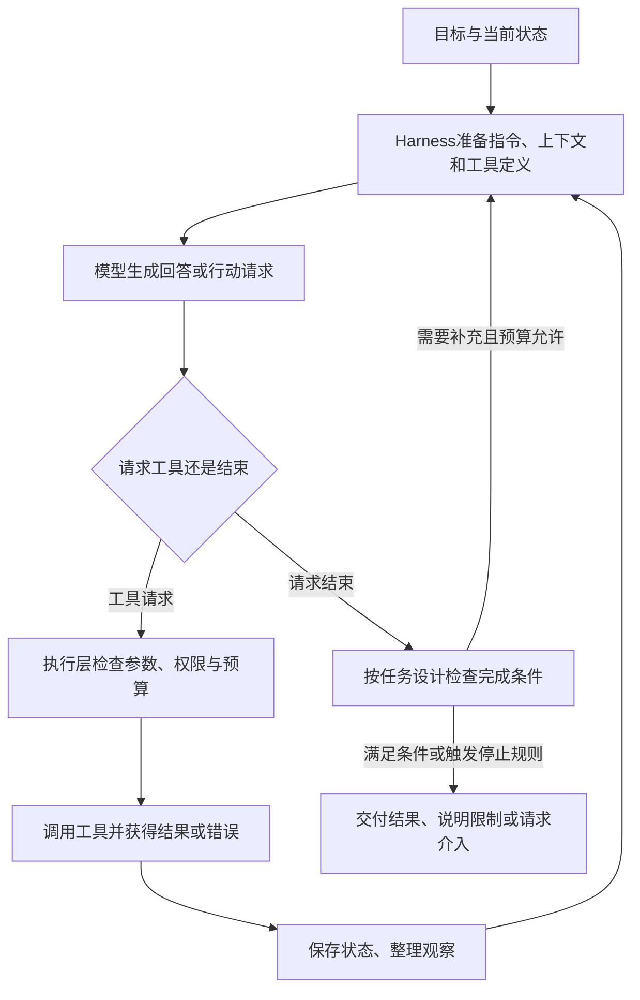

# Harness Engineering：Agent的运行支撑与反馈工程

## 核心认识

**Harness Engineering 是围绕模型与 Agent 设计、实现和迭代运行支撑、工作环境及反馈机制的工程实践，使模型能力能够转化为可执行、可观察、可验证的任务过程。** 这里的中文解释是工作性表述，不声称存在唯一标准译名或统一组件清单。

Agent 是承担目标、依据观察选择行动的系统；Agent Harness 是使它运行起来的软件支撑；Harness Engineering 是构建和改进这些支撑的工作。三者处于不同讨论层次。本文限定在基于 LLM 的 Agent 语境，具体 Agent 边界沿用 [[Agent入门：Workflow、ReAct与平台]]；不把此处关系外推为所有人工智能智能体的定义。[S1、S2、S6]

核心联系是：**Harness 通常参与 Agent 的实现，工程工作则改善 Agent 如何获取信息、执行行动、保存状态和核验结果。** Agent 的决策循环与 Harness 的执行逻辑存在组成关系，不能将二者当作两个彼此独立、互相竞争的方案。

## 1. 先分清对象、组成部分与工程活动

| 概念 | 主要回答什么 | 教学例子 |
| --- | --- | --- |
| 模型（LLM） | 怎样依据输入生成判断、内容或工具请求？ | 判断先查哪份资料，提出读取文件的请求 |
| Agent | 怎样围绕目标、利用观察决定并推进下一步？ | 收集资料、写笔记、根据检查反馈修订 |
| Agent Harness | 哪些软件机制把上述过程组织并执行起来？ | 组装上下文、调度工具、保存会话、落实权限与预算 |
| Harness Engineering | 怎样设计和改进这些机制及相关工作环境？ | 补齐校验、改善工具反馈、调整状态保存与完成条件 |

LangChain 的文章用 `Agent = Model + Harness` 表达一种工程拆解，并把模型之外的代码、配置与执行逻辑纳入 Harness。这是该作者选择的分析边界，不是普遍数学定义；不同产品也可能把工具实现、环境或平台划在不同组件中。[S2]

同一个模型配上不同工具、上下文策略和运行约束，可以形成行为不同的系统。反过来，给模型换一个角色名称，也不意味着更换了 Harness。[S1]

## 2. 阅读资料时，先确认作者采用多宽的范围

查阅资料后可归纳出两个侧重点，二者有重叠，不是统一行业分类：

- **运行支撑侧：** VS Code 文档将 Harness 描述为运行 Agent 会话的软件层，强调上下文、工具、执行循环、权限与会话状态。[S1]
- **工作环境侧：** OpenAI 的 Harness Engineering 文章还关注仓库知识、文档组织、架构规则、自动检查与可观测性，使代码和环境便于 Agent 理解、操作和验证。[S3]

因此，Harness Engineering 可以涉及运行时开发，也可以涉及已有 Agent 周围的文档、工具和反馈环境。本文兼顾两者，并在讨论组件时注明侧重点；不能据此声称每个项目必须自行开发一套 Agent 框架。

## 3. Harness 怎样参与一次任务

以下为职责示意，依据 S1 整理，不对应某一产品的进程架构：

模型可以决定想做什么，运行系统决定请求怎样被承接、允许或拒绝。工具返回的错误、权限拒绝与检查失败也可以成为后续观察；循环并不保证目标最终达成。完成核验的强度由任务设计决定，并非所有现成 Harness 都有独立的业务验收器。[S1、S6；图中完成检查为教学归纳]

可将工程职责按下面的问题检查。该分组是助手归纳，具体实现可合并或拆分：

| 工程问题 | 常见支撑 | 可观察的失败例子 |
| --- | --- | --- |
| 模型本轮能看到什么？ | 指令、检索、上下文筛选和压缩 | 关键规则未进入输入，长工具输出挤占上下文 |
| 行动请求怎样变成真实操作？ | 工具描述、参数校验、调度与结果回传 | 工具名称正确但参数错误，或执行失败未返回 |
| 多轮或跨会话怎样接续？ | 状态持久化、进度记录、恢复入口 | 上下文重置后重复工作，遗漏未完成事项 |
| 什么操作允许做、何时必须停？ | 执行权限、隔离、人工介入、时间和调用预算 | 把自然语言约束误当成硬权限，反复重试不退出 |
| 怎样判断结果并改进系统？ | 任务验收、日志／trace、评测与回归检查 | 只有“我完成了”的自述，没有验收证据 |

基础运行职责见 S1、S2；跨会话问题见 S4；工程迭代见 S5。权限需要执行机制落实；文档与 Prompt 中的提醒可以引导行为，但不能替代访问控制。

## 4. 用知识库整理任务理解联系与区别

自拟教学任务：“介绍协同过滤，并形成可追溯的学习笔记。”以下是职责映射，不是对当前客户端内部实现的审计，也未新建或实测一套 Harness。

| 层次 | 在这个任务里做什么 |
| --- | --- |
| 模型能力 | 理解概念，比较方法，组织文字，判断下一步需要什么证据 |
| Agent 行为 | 查已有笔记、查来源、写入、读检查结果，再决定补充或交付 |
| 运行支撑 | 提供文件与搜索工具，回传真实结果，传递状态，按配置限制操作 |
| 工作环境 | 提供真实目录、集中维护的规则、模板、来源记录和导航 |
| 工程改进 | 将反复出现的缺口变成更明确的规则、更易用的工具或可执行检查 |

此前在本库补充 AI 主题范围和预测方法归档说明，就是一次**文档与环境侧**的改进：把依赖临时解释的边界写成可重复查阅的规则。这个映射采用较宽的 Harness Engineering 视角，不表示一份目录说明本身就是完整的 Agent Harness。

如果以后频繁出现失效链接，可以把“请注意链接”进一步落实为检查脚本，并让检查结果进入修订流程。脚本通过只证明它覆盖的结构规则通过，不证明笔记事实正确；来源核验仍要另做。这是工程设计建议，本文未新增该脚本。

## 5. 与相邻概念按关注问题区分

| 概念 | 关注的问题 | 与 Harness Engineering 的关系 |
| --- | --- | --- |
| Prompt Engineering | 指令、例子与输出要求怎样表达？ | 指令设计可参与 Harness 改进，但不能代替真实工具执行 |
| Context Engineering | 每轮怎样提供合适的信息？ | Harness 可以实现检索、压缩、状态恢复等上下文交付机制 |
| Workflow／ReAct | 路径由程序预定义，还是依据反馈动态选择？ | 是控制方式／行动模式，可由运行支撑实现，边界见既有主文 |
| 框架／SDK／平台 | 用哪些可复用组件构建、运行与管理？ | 可以提供 Harness 能力；“Harness”描述职责，“框架”等描述软件组织与交付方式 |
| 微调／模型训练 | 怎样通过训练改变模型参数？ | 改上下文、工具或执行逻辑通常不改权重，两类改进可以结合 |
| 多 Agent | 是否把局部目标和决策职责分给多个智能体？ | 是可选架构；单 Agent 同样需要运行支撑，多 Agent 不保证更可靠 |

这张表是结合 S2、S5、S6 与库内主文的工程辨析，不主张存在互斥或严格包含的统一分类，也不把这些术语排成必须依次经历的升级路线。专项机制分别见 [[提示词工程]]、[[ReAct]]、[[Agent平台、框架与应用]] 和 [[多Agent与单Agent模块化：区别与选择]]。

## 6. 分清任务中的反馈与对 Harness 的改进

一次任务内，模型读取工具结果或测试失败，随后改方案继续执行，这是**任务执行反馈**。设计者分析多次运行的失败轨迹，改变工具接口、上下文策略、检查机制，再重新评测，这是**对运行支撑的工程迭代**。后者也可以由自动化或 Agent 辅助完成，但需要评测支持，而非仅接受模型的自评。[S5；两层反馈的命名为助手归纳]

LangChain 的实践文章展示了保持模型不变、调整 Harness 并观察基准变化的案例；本文只用它支持“模型之外的设计可以影响结果”，未复现其分数，也不将其增益外推到本库或其他任务。[S5]

Anthropic 的长任务文章强调，跨会话仅做上下文压缩还不够，需要明确的任务清单、进度交接和验证。其初始化与后续执行方案是一个案例，不能推断 Harness 必须包含多个 Agent。[S4]

可从具体失败出发迭代：**保留失败记录 → 区分信息、工具、状态、权限和验收缺口 → 作最小相关调整 → 在目标任务与回归样本上比较质量、成本和耗时。** 这是实践建议，未在本轮实施实验。

## 适用边界与常见误区

- Harness Engineering 主要改变系统与环境；无法凭空补足模型不具备的全部能力。
- Harness 可以包含执行循环本身，不能把“循环属于 Agent，所以 Harness 只能是外部工具箱”当成固定边界。
- 文档、Skills、工具协议、沙箱或评测各自可能参与工程工作，任意单项都不自动等于完整 Harness。
- 更长 Prompt、更多工具、更复杂框架或更多 Agent，均不自动带来更好结果；看具体瓶颈与评测。
- 停止不只包括成功，也可包括权限限制、预算耗尽、外部故障或必须由人判断；交付应区分这些状态。
- “保证结果”是过强表述。运行约束和验证增加可控性与证据，仍受检查覆盖、事实质量和模型错误影响。

## 来源与核验

学习出处：用户询问 Harness Engineering 是什么、与 Agent 有何联系和区别，未指定外部课程或文章。本次无指定外部学习材料；以下是助手补充资料，不冒充原课程出处。实际查阅日期为 2026-10-20；术语范围是对本轮资料的比较归纳，后续阅读应核对具体作者的定义。

| 编号 | 已查阅依据 | 支持范围与阅读边界 |
| --- | --- | --- |
| S1 | Microsoft，[Understand agent harnesses](https://code.visualstudio.com/docs/agents/concepts/agent-harnesses) | 查阅定义、单轮流程和概念对照；支持运行软件层、上下文、工具、状态及与执行环境的区别。未测试产品集成 |
| S2 | Vivek Trivedy／LangChain，[The Anatomy of an Agent Harness](https://www.langchain.com/blog/the-anatomy-of-an-agent-harness) | 查阅定义与核心组件、文件存储、上下文和长任务相关正文；支持作者的模型加 Harness 拆解及组件示例，不作为统一标准 |
| S3 | OpenAI，[Harness engineering: leveraging Codex in an agent-first world](https://openai.com/index/harness-engineering/) | 查阅环境设计、仓库知识、架构约束和反馈相关正文；支持较宽的工作环境视角。其团队产出、自动合并等实践不作为本库操作授权或普遍建议 |
| S4 | Anthropic，[Effective harnesses for long-running agents](https://www.anthropic.com/engineering/effective-harnesses-for-long-running-agents) | 查阅跨上下文问题、初始化与后续执行、进度交接及测试段落；支持长任务接续，未运行其示例 |
| S5 | Vivek Trivedy／LangChain，[Improving Deep Agents with harness engineering](https://www.langchain.com/blog/improving-deep-agents-with-harness-engineering) | 查阅工程目标、trace 反馈、验证与中间件调整正文；支持保持模型不变的系统迭代案例。未复现基准和性能数字 |
| S6 | Anthropic，[Building effective agents](https://www.anthropic.com/engineering/building-effective-agents) | 查阅 Agent／Workflow 定义、行动反馈、停止条件与评测原则；不把其架构术语当作唯一行业命名 |

对照表、流程图、知识库任务与两层反馈为助手教学归纳；未实现运行时、未修改执行权限、未获得 Harness 改进效果。事实核验、笔记成熟度与个人掌握分别判断。

## 关联与自查

- [[Agent入门：Workflow、ReAct与平台]]：已有 Agent 系统主干与控制方式。
- [[工具调用与执行系统]]：请求、校验、执行和真实结果的具体分工。
- [[记忆能力(短期记忆与上下文窗口、长期记忆与数据库)]]：状态与跨会话信息的职责。
- [[Agent平台、框架与应用]]：工程职责与软件交付形式的区别。

自查题，尚未作答：

1. 模型完全相同，只改变工具错误返回与完成检查，为什么可能改变 Agent 表现？
2. 在 Prompt 写“禁止越权”与执行层检查权限，各自能提供什么保障？
3. Agent 根据一次测试失败修复产物，与工程人员修改测试接入机制，分别改了什么？
