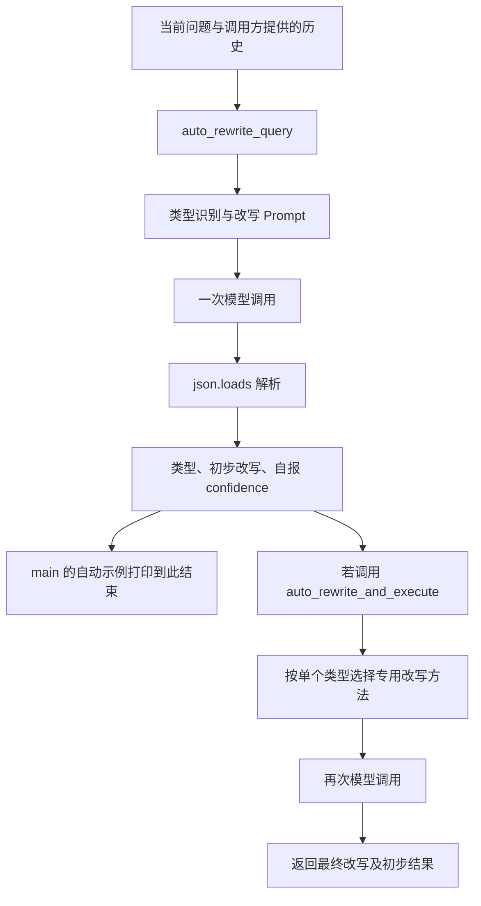
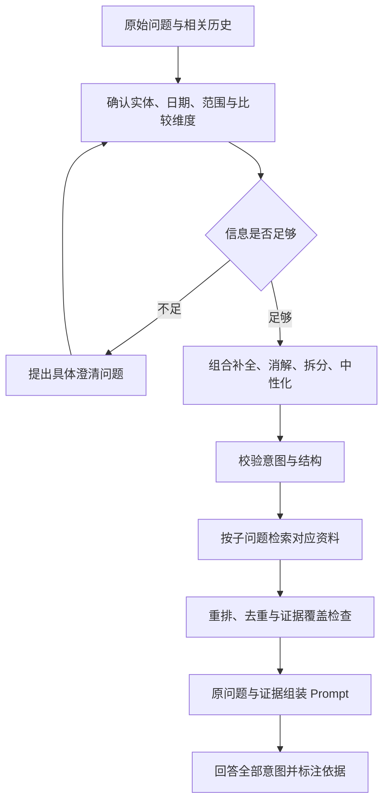

# Query改写案例：上海迪士尼客服问答

## 任务与材料范围

本案例学习怎样把客服对话中的省略、对比、指代、多个问题和反问，转换成可执行的检索请求。依据为课程 PDF 第 36–45 页，以及 `CASEA-Query改写` 工程中的两个 Python 文件和依赖清单；主要分析 `1-Query改写.py`，第二个文件只用于说明联网扩展的边界。

**这是查询处理组件的示范。** 原工程没有客服知识库、Embedding、向量索引、检索结果或最终客服答复。它将人工编写的对话和问题放进 Prompt，调用模型并打印改写结果。接入 RAG 的方法在后文作为改进建议说明。

**五类 Query 帮助发现查询困难，处理时应按需要组合补全、消解、拆分、中性化与澄清，并保留原始意图。** 既有代码与隔离核验确认：`main` 的自动示例没有传入历史，两阶段自动路径未让历史贯穿后续改写，JSON 能解析也不保证输出类型符合接口。这些是具体调用路径的问题，不表示 `auto_rewrite_query` 本身不能接收历史；五类也不是互斥、穷尽的通用分类。静态与预设响应核验尚不能证明真实改写质量或召回提升。

本文区分三种内容：课件展示的输入与输出、代码及离线模拟能确认的行为、助手提出的建议方案。没有调用 DashScope 或实测模型改写质量。课件中的设施名称、园区归属、表演和售罄情况只是教学对话，未核验为真实业务事实；本文不提供当前门票、开放时间或游玩建议。

通用定义、Prompt 骨架和评估方法集中在 [[RAG中的Query改写]]；本篇保留五类具体对话及代码推理过程。

## 程序怎样处理一次请求

### 文件与调用入口

| 文件或函数 | 实际职责 |
| --- | --- |
| `requirements.txt` | 指定 `dashscope==1.22.1`，本轮未安装该依赖 |
| `get_completion`，第 11–19 行 | 默认模型名为 `qwen-turbo-latest`；调用 `dashscope.Generation.call`，取出返回消息文本 |
| `QueryRewriter`，第 22–211 行 | 五个专用方法，以及自动识别、按类型再次改写两个方法 |
| `main`，第 213–304 行 | 五个专用示例各调用一次；另外循环调用 `auto_rewrite_query` 测试五个问题 |
| `2-Query联网搜索改写.py` | 判断联网需求、生成搜索 Query 和搜索策略；没有执行搜索 |

`get_completion` 的核心输入如下：

```python
messages = [{"role": "user", "content": prompt}]
response = dashscope.Generation.call(
    model=model,
    messages=messages,
    result_format="message",
    temperature=0,
)
return response.output.choices[0].message.content
```

API Key 从环境变量 `DASHSCOPE_API_KEY` 读取。对话历史是拼进当前 Prompt 的文本，不是 SDK 自动维护的会话；每次 `messages` 只有这一条消息。更换用户或遗失历史后，模型不会凭这个调用接口自动记住之前的问题。`temperature=0` 是代码配置，不是语义正确性证明。

### 两种自动入口不能混为一谈



- `auto_rewrite_query`：一次调用同时要求识别类型和给出改写，返回 `query_type`、`rewritten_query`、`confidence`。
- `auto_rewrite_and_execute`：先得到上述结果，再按类型调用一个专用方法；匹配已知类型时通常是两次模型调用。第二次传的是**原问题**，第一轮改写只作为 `auto_rewrite_result` 留在返回对象中。
- `main()` 实际调用前者，没有调用后者。它的五个自动问题都没有传入历史或 `context_info`，虽然人工读者能从示例主题猜到迪士尼，模型不能从终端标题获得这些背景。若十次调用均顺利完成，整个 `main` 为五次专用调用加五次自动调用，合计十次；本轮没有实际执行这十次云端请求。

因此，课件第 44 页有些输出残留“之前提到的”“这”，或请求补充园区名称，应结合**输入是否给足**分析；不能只归因于模型能力。

## 五类 Query 的逐例分析

### 1. 上下文依赖型：还有其他设施吗

**课件第 38 页／demo 第 218–232 行。** 前文询问上海迪士尼乐园的新项目，助手提到“疯狂动物城”主题园区，随后列出“疯狂动物城警察局、朱迪警官训练营、尼克狐的冰淇淋店”。当前问题是：

> 还有其他设施吗？

课件展示的改写是：

> 除了疯狂动物城警察局、朱迪警官训练营和尼克狐的冰淇淋店之外，‘疯狂动物城’园区还有其他设施吗？

对应 `rewrite_context_dependent_query(current_query, conversation_history)`。Prompt 要求依赖上下文时生成完整问题，否则返回原问题。

**它补回了什么？** “设施”属于哪个园区；“其他”相对于哪一组此前提及的名称。直接检索“还有其他设施吗”缺少对象，也缺少排除范围。课件改写比原问题更明确，但没有保留“上海”这个地点；只有实体在当前知识库中唯一时才能省略。

**还需检查什么？** 课件名单来自历史助手回复，不能自动成为权威设施清单。若这些名称未经证实，继续扩写会把前一次回答的错误固化为前提。

一种建议处理是：用“上海迪士尼乐园‘疯狂动物城’主题园区的官方设施清单”检索真实资料，同时保留原始问题和此前名称。生成阶段先核对此前介绍，再回答哪些确实是新增信息。这里的检索 Query 获取完整清单，回答任务仍保留“其他”的要求；不能把所有已介绍设施再次列出就当作完成回答。

**本例学到的操作：** 从相关历史补全地点、实体与范围，区分“对话里提过”和“资料确认存在”。

### 2. 对比型：哪个游玩时间更长、更有趣

**课件第 39 页／demo 第 234–246 行。** 历史助手把“疯狂动物城主题园区”和“蜘蛛侠主题园区”列为上海迪士尼的新项目。当前问题是：

> 哪个游玩的时间比较长，比较有趣？

课件展示的改写明确了这两个对象，并询问哪个游玩时间更长、更有趣。对应 `rewrite_comparative_query(query, context_info)`；在自动执行入口中，`context_info` 为空时改用历史。

**对象明确之后还有两层歧义：** “游玩时间”是单项体验时长、排队时间，还是整个园区建议停留时间？“有趣”是用户关注刺激程度、主题故事，还是儿童适合程度？这些维度的资料和判断方式不同。

同时，两个园区的存在、归属和历史助手的介绍未核验，不能因比较对象被写全就确认其真实。建议先澄清或核对用户指的是哪些具体项目，并确认时长含义与偏好。

假设已经确认项目 A、项目 B，并明确比较的是**单项体验时长及用户指定的体验特点**，可计划四条请求：

```text
项目 A 的单项体验时长
项目 B 的单项体验时长
项目 A 在用户指定维度上的体验特点
项目 B 在用户指定维度上的体验特点
```

以上 A／B 是处理结构示意，不是真实园区或可直接发送的完整 Query；执行前必须替换为已确认名称和维度。资料齐备后，再比较两者，说明主观判断的依据。若知识库已有直接比较资料，也可以保留一个完整的比较 Query，不一定要拆成四条。

**本例学到的操作：** 确定比较对象、维度和共同条件，分别取得证据，再进行比较。明确名称只是其中一步。

### 3. 模糊指代型：都什么时候开始

**课件第 40 页／demo 第 248–260 行。** 前文提到上海迪士尼乐园和香港迪士尼乐园的烟花表演。当前问题是：

> 都什么时候开始？

课件展示的改写是：

> 上海迪士尼乐园和香港迪士尼乐园的烟花表演都什么时候开始？

对应 `rewrite_ambiguous_reference_query(current_query, conversation_history)`。这里“都”指向两个乐园的表演，属于指代消解，也依赖上下文。

建议先确认查询的是哪一天、哪些具体演出；如果要回答某个游玩日的场次，日期会影响检索范围。然后分别查询上海、香港的对应演出开始时间，最终回答时逐项对应，避免把两个地点合成一个时间。历史声称“两地都有烟花”仍需实际资料确认。

如果前文还提过巡游、舞台演出等多个活动，“都”可能有多种指向，应询问具体对象。模型自报较高置信度不能替代指代依据。

**本例学到的操作：** 把代词绑定到可追溯的实体集合，同时保留每个对象的答案对应关系。指代明确不等于日期、场次和业务事实都已明确。

### 4. 多意图型：票价、预约、停车费一起问

**课件第 41 页／demo 第 262–269 行。** 输入为：

> 门票多少钱？需要提前预约吗？停车费怎么收？

课件展示把它拆成三个问题。对应 `rewrite_multi_intent_query(query)`，只接收当前问题，**没有历史参数**。

拆分能让票价、预约规则、停车收费各自获得证据，但“门票”“停车”仍未指明地点。`main` 的打印标题提到迪士尼，不会自动进入该方法的 Prompt。

假设用户已经明确询问上海迪士尼乐园，建议改写为：

```json
[
  "上海迪士尼乐园门票价格如何规定？",
  "上海迪士尼乐园是否要求提前预约？预约规则是什么？",
  "上海迪士尼乐园停车场收费规则是什么？"
]
```

这是助手整理的教学输出，不是模型本轮返回值。若用户要某日、某种票的具体报价，还需保留或澄清日期与票种；不能自己填入金额。三个请求分别取回资料，合并去重后，最终答案覆盖三问，并说明哪些仍缺证据。

**JSON 与打印形式要分开：** 原方法先 `json.loads(response)`，再由 `main` 打印返回对象。合法 JSON 的双引号数组解析成 Python 列表后，打印时也可能显示单引号。所以第 41 页的显示形式不是严格 JSON，但不能仅凭显示形式断定模型输出解析失败。

原方法的解析失败回退为 `[response]`。这会把整段无效输出包装成单元素列表，并不代表拆分成功；而且合法 JSON 对象也会被原样返回，代码没有校验结果是否为字符串数组。后文给出离线复现。

**本例学到的操作：** 先补全所有子问题共享的对象和条件，再拆分；格式能解析和每问能独立检索是两项不同要求。

### 5. 反问型：不会要提前一个月预订吧

**课件第 42 页／demo 第 271–284 行。** 用户计划下周六去上海迪士尼；历史助手声称目标日已售罄，用户说朋友上周还能买到当天票。当前问题是：

> 这不会也要提前一个月预订吧？

课件展示的改写是：

> 迪士尼乐园门票是否需要提前一个月预订？

对应 `rewrite_rhetorical_query(current_query, conversation_history)`。它消除了反问语气，但省略了“上海”和目标游玩日。

建议先保留完整问题草稿：

> 计划下周六前往上海迪士尼乐园，购买该日门票是否要求提前一个月预订？相关提前购票规则如何规定？

这里的“下周六”还需要依据**提问时的日期和时区**锚定，必要时澄清具体游玩日期。原课程对话发生日未知，不能使用本次阅读日期替它计算。确认日期后，再形成可独立执行的请求。

要保留的核心疑问是“是否存在提前一个月预订的要求”。不能直接改成“需要提前一个月预订”，也不能改成“什么时候去更好”。售罄、允许提前购票、必须提前购票和建议提早购票是不同问题，应分别核对；朋友曾买到当天票不证明目标日有票，历史助手说售罄也不证明已查询真实库存。

生成阶段可以回应用户的担忧，并依据证据说明规则；语气中性化不应导致日期、地点或用户担忧丢失。

**本例学到的操作：** 把反问转成待验证问题，保留否定关系、条件和关注点，避免把猜测变成事实。

## 自动识别的输出怎样检查

课件第 43 页与 `auto_rewrite_query` 使用五类单标签提示及关键词线索；第 44 页展示统一输出。这些线索可以辅助判断，但一个问题可能同时具有多种特征。“都什么时候开始？哪个持续更久？”同时涉及指代、上下文、比较和多意图，应组合处理。

| 第 44 页原问题与展示结果 | 要检查的地方 |
| --- | --- |
| “还有其他游乐项目吗？” → “除了之前提到的……” | 仍依赖历史；对象和此前名单没有补全 |
| “哪个园区更好玩？” → “请明确是哪些园区” | 这是澄清请求，应先交给用户，不能当作检索 Query；还需明确评价维度 |
| “都适合小朋友吗？” → “哪些产品或活动适合小朋友？” | 从检查已知对象是否全部适合，变成开放推荐，丢失范围及量词 |
| “有什么餐厅？价格怎么样？” → 两问连在一句话里 | 没明确地点，也没有结构化拆成多个可执行请求；格式应匹配下游接口 |
| “这不会也要排队两小时吧？” → “这需要排队两小时吗？” | “这”仍未消解；具体项目及目标时段可能决定排队信息 |

`auto_rewrite_and_execute` 用 `if/elif` 只选一个专用方法；没有组合操作机制。多意图分支收到原始 Query，没有历史，也没沿用第一轮已经补全的 Query，所以会丢失共享背景。返回的 `confidence` 来自第一轮，并没有评价第二轮结果；JSON 解析失败时出现的 `0.5` 是代码默认值。第 44 页的 `0.95` 也只是展示的自报值，没有校准或正确率依据。

## 离线核验：哪些问题已确认

本轮对两份脚本做了 AST 语法解析。随后只加载原 `QueryRewriter` 类，替换 `get_completion` 为预设响应函数，在内存中调用原方法；不导入 DashScope，不读取 Key 值，不发网络请求，也没有改动 demo。

| 核验输入与预设响应 | 原方法实际结果 | 能证明什么 |
| --- | --- | --- |
| 历史为“我在问上海迪士尼乐园门票”；问题为“多少钱？需要预约吗？”；第一轮预设多意图及补全结果，第二轮预设 JSON 数组 | 两次调用；第一轮 Prompt 包含历史，第二轮不包含；最终返回第二轮数组 | 自动执行分支会丢失历史输入，第一轮补全结果不进入第二轮 |
| 多意图模型响应预设为 `['门票多少钱？', '需要预约吗？']` | 返回 `["['门票多少钱？', '需要预约吗？']"]` | 真正收到单引号文本时解析失败，回退成一个字符串元素，未完成拆分 |
| 多意图响应预设为 `{"foo": "bar"}` | 返回该字典 | JSON 语法合法不等于满足字符串数组结构，原方法没有类型校验 |
| 自动识别响应预设为 `not JSON` | 返回未知类型、原 Query、`confidence=0.5` | 回退是预设逻辑，不是模型完成了改写或有 50% 正确率 |

这些核验确认的是程序分支与解析行为，不能证明真实模型一定产生上述响应，也不能证明建议改写提高召回。`get_completion` 直接取返回字段，未展示服务状态、缺失字段及网络异常的处理；当前服务可用性未验证。

## 怎样接入客服 RAG

下面是助手建议的后续流程，原 demo 没有实现：



例如“票价、预约、停车费”分别对应票务、预约规则和停车资料。向量检索时，用兼容的 Embedding 配置编码子 Query；对结构化票价或指定日期的动态信息，也可按系统已接入的资料能力选择查询接口。具体库结构与路由设计见 [[RAG中的多知识库组织与路由]]，不是必须建三个物理数据库。

接入前最直接的改进是：让每个专用方法都能接收必要历史或已确认的独立问题；允许多种操作组合；区分 `passthrough`、`rewrite`、`clarify`；校验结果类型与条件保留情况；原问题始终进入最终生成任务。完整通用模板见 [[RAG中的Query改写#怎样按类型实现改写]]。

`2-Query联网搜索改写.py` 仅进一步展示“判断需不需要联网 → 生成搜索 Query → 生成策略”。它没有搜索工具调用或结果。历史只传给联网判断，后续改写及策略仍只收到原问题；`rewrite_for_web_search` 的提示有 `2024年` 示例，只有策略阶段注入 `datetime.now()`。因此联网需求识别、时间锚定、搜索执行、结果验证需要分别检查，本例不把生成策略称为已经查到资料。

## 怎样判断这个案例做对了

对五类问题，先检查对象、地点、日期、否定、量词、比较维度及意图数量有没有保留；对信息不足的问题，检查是否合理澄清。接入真实知识库后，再固定检索配置，比较原始与改写 Query 的证据覆盖、最终答案完整性、延迟与费用，不能只看改写是否流畅。

可用三个小问题复习，个人掌握尚未验证：

1. 为什么“都适合小朋友吗”与“哪些活动适合小朋友”不是同一个任务？
2. 为什么模型第一轮看到了上海迪士尼，第二轮仍可能丢失地点？
3. 把反问变成中性问题后，哪些信息仍需要原样保留，哪些事实必须另查？

## 来源与核验

- 学习出处：[[AI大模型应用课件：RAG技术与应用]] 第 36–45 页，已阅读文字并查看完整相关页渲染；课件展示输出不是本轮模型实测。
- 本地工程：[Query 改写脚本](../../../../80_Local/Courses/AI大模型应用课件/5-RAG技术与应用/CASEA-Query改写/1-Query改写.py)、[联网改写脚本](../../../../80_Local/Courses/AI大模型应用课件/5-RAG技术与应用/CASEA-Query改写/2-Query联网搜索改写.py)、[依赖清单](../../../../80_Local/Courses/AI大模型应用课件/5-RAG技术与应用/CASEA-Query改写/requirements.txt)。文件在 Git 忽略的本机目录，新设备需要另行恢复资料。
- 本轮主脚本 SHA-256：`751286f325b4ac6e076b66e6cd70de2557cb57308f3220ea539e6b973e7c05f0`；联网脚本：`7704bf4273bdef7d1aa14ce2fdef7560d13a3d7f44884a3188b737279400e573`。用于识别阅读版本，不是效果指标。
- 已核验：静态调用结构、两份脚本语法、原类在预设响应下的调用次数、历史传递及 JSON 回退／类型行为。
- 助手补充：建议改写、澄清条件、检索分解及 RAG 接入方案。未调用真实模型、执行检索或搜索、验证当前 Disney 信息、修改 demo 或证明召回提升。
- 相关概念：[[RAG中的Query改写]]、[[提示词工程]]、[[RAG的失败诊断与反馈迭代]]。原理依据由概念正文维护，本案例依据课件、代码和明确标注的离线核验。
