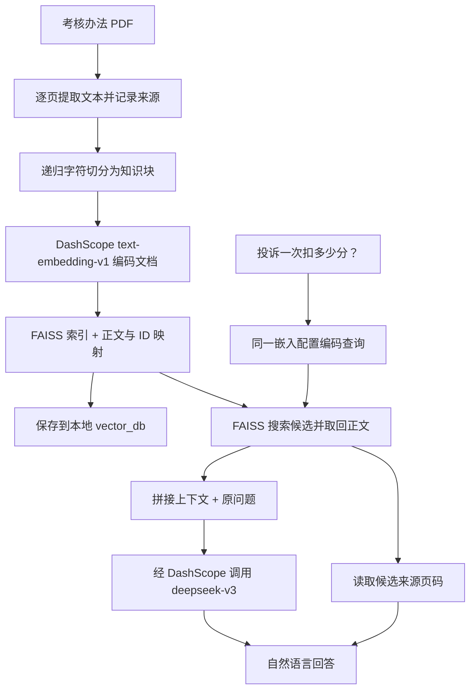

# 客户经理考核PDF问答案例：从文档到回答与页码溯源

## 任务与阅读范围

本案例把一份客户经理考核办法 PDF 变成可自然语言提问的知识库。它回答两个具体问题：

1. “客户经理被投诉了，投诉一次扣多少分？”
2. “客户经理每年评聘申报时间是怎样的？”

依据为课件 PDF 第 19–31 页，以及 `CASE-ChatPDF-Faiss` 下的 Python 脚本、Notebook、依赖清单、输入 PDF 和已有索引产物。课件解释搭建思路，demo 展示一套实现，两者有差异。本笔记将**来源展示结果、静态代码事实、离线核验和改进建议**分别说明，不把已有 Notebook 输出称为本机刚运行的结果。

输入 PDF 共 9 页，正文标题为《上海浦东发展银行西安分行个金客户经理管理考核暂行办法》。它是课程提供的业务示例，发布日期和当前有效性未确认；下面的分值与月份只解释这份材料的问答，不作为现实银行现行制度。

## 先看一次问答到底如何发生



**向量参与找内容，取回的正文参与回答，元数据参与溯源。** 程序没有训练或微调 DeepSeek，也没有把 PDF 写进模型参数；每次调用时，把本次取回的正文放进 Prompt。这是 [[RAG（检索增强生成）]] 的具体应用。

本案例的“本地知识库”指 PDF 与 FAISS 产物保存在本地。文档与查询的 Embedding、回答生成仍调用 DashScope 云服务；不等于整条链路离线或数据全程留在本机。

## 组件各自负责什么

| 组件 | 本案例中的职责 | 不应混淆的边界 |
| --- | --- | --- |
| PyPDF2 `PdfReader` | 读取 PDF 并提取每页文字 | 不负责 OCR、保证表格结构或判断制度有效性。 |
| `RecursiveCharacterTextSplitter` | 按给定分隔符与长度限制切块 | 不自动理解完整业务条款，也不自动生成准确页码。 |
| `DashScopeEmbeddings` | 调用 `text-embedding-v1` 生成文档／查询表示 | 它是远端模型的调用封装，不是本机下载运行的模型。 |
| LangChain `FAISS` 封装 | 组合向量索引、Docstore 和索引到文档 ID 的映射 | 底层 [[FAISS]] 负责近邻搜索；正文由封装层管理。 |
| `Tongyi` 封装 | 经 DashScope 接口调用代码指定的 `deepseek-v3` | 类名叫 Tongyi 不代表本次模型一定是 Qwen。 |
| 应用代码 | 拼接上下文、调用模型、打印回答和来源 | Prompt、来源展示与质量检查需要应用显式实现。 |

## 第一阶段：从 PDF 到知识块

### 1. 文本与页码必须一起保留

demo 脚本第 13–36 行按 PDF 物理顺序、从 1 开始逐页提取：

```python
text += extracted_text
char_page_mapping.extend([page_number] * len(extracted_text))
```

`text` 是拼接后的字符串；`char_page_mapping[i]` 表示 `text[i]` 来自哪一页。这里实际返回 `List[int]`，函数声明中的 `List[Tuple[str, int]]` 与实现不一致，属于类型注解问题。

这个映射只在字符序列没有发生未跟踪变化时成立：清理页眉、移除空白、插入分隔符或重组表格之后，需要保留或更新对应关系。demo 只是打印没有文字的页面，没有 OCR 或完整异常处理。

材料第 3–4 页的考核标准表跨页，且有合并单元格；提取成普通文字后会丢失行列结构。问“投诉扣多少分”能从普通条文回答，不代表同样流程已能可靠处理所有表格问题。

**已有结果与本轮结果不同：** 课件第 27 页和 Notebook 保存输出均为 3881 个字符；本轮用环境中的 pypdf 读取同一份 PDF 得到 3817 个字符。demo 指定 PyPDF2 3.0.1，本环境未安装该版本，因此没有把两者当成相同解析配置的复现。空白差异会影响字符偏移，必须在同一次解析结果上建立映射。

### 2. 看懂分块参数，而不是只记住数字

demo 第 51–59 行配置：

```python
RecursiveCharacterTextSplitter(
    separators=["\n\n", "\n", ".", " ", ""],
    chunk_size=1000,
    chunk_overlap=200,
    length_function=len,
)
```

`1000` 是 Python `len` 口径的字符长度上限，不是 1000 tokens。分割器优先尝试较粗边界，过长时使用更细边界；空字符串表示最终可以退到逐字符。这里句号分隔符是英文 `.`，不能直接称为按中文句子完整切分。

重叠用于让边界附近的语境在相邻块中重复出现。`chunk_overlap=200` 是配置的目标／上限，不表示相邻块每次都正好重叠 200 个字符。本案保存的五块中，实际连续重叠为 169、165、179、173 个字符。

已有 `page_info.pkl` 的五个键就是切分块；静态检查 `index.pkl` 中的五段正文，与这些键内容及顺序相同：

| 块 | 长度 | 在 Notebook 保存全文中的真实范围 `[start,end)` | 覆盖的 PDF 页 | 主要内容摘要 |
| --- | ---: | --- | --- | --- |
| C1 | 983 | `[0,983)` | 1–3 | 总则、职位职责，进入基础素质要求。 |
| C2 | 977 | `[814,1791)` | 2–5 | 基础素质、考核标准表及说明，进入工作质量考核。 |
| C3 | 995 | `[1626,2621)` | 4–6 | 折算说明、投诉等扣分条款，进入聘任考核程序。 |
| C4 | 979 | `[2442,3421)` | 6–8 | 聘任条款、考核待遇，进入后续等级标准。 |
| C5 | 629 | `[3248,3877)` | 7–9 | 收入分配末段、管理奖惩和附则。 |

这些是对已有产物与保存文本的离线核对，不是本轮重新调用切分器得到的结果。C1–C5 是本笔记为解释添加的编号，原 demo 没有这些显式 ID。原始条款跨页、块跨页，都说明不能把块序号当成页码。分块的一般取舍见 [[RAG中的长文档语义切片]]。

## 第二阶段：向量化、索引与持久化

### 1. `from_texts` 把几件工作封装在一起

demo 第 63–69 行：

```python
embeddings = DashScopeEmbeddings(
    model="text-embedding-v1",
    dashscope_api_key=DASHSCOPE_API_KEY,
)
knowledgeBase = FAISS.from_texts(chunks, embeddings)
```

按查阅到的官方封装源码，`from_texts` 调用文档编码，再建立索引、保存 `Document` 正文，并建立索引行号到 Docstore ID 的关系。只有一行调用，不代表内部没有这些步骤。

本地已有 `index.faiss` 的 Flat 文件头静态读数为 **1536 维、5 条向量**；它是保存产物的属性，不证明任何今天调用的模型都返回同样维度，也不能证明模型版本完全一致。未在本轮实际加载索引或执行相似度搜索。

官方当前实现的默认路径使用 `IndexFlatL2`，即精确平方 L2 距离近邻搜索；demo 没有显式指定归一化或距离策略，因此不能把 `similarity_search` 名称直接理解成“余弦搜索”。当前源码说明不是对 demo 锁定版本安装运行的替代；度量的具体定义见 [[欧氏距离与平方欧氏距离]]。

### 2. 三个文件保存的东西不同

| 文件 | 作用 | 为什么不能只保存一个文件 |
| --- | --- | --- |
| `index.faiss` | FAISS 向量及索引结构 | 只凭向量不能无损恢复原文。 |
| `index.pkl` | LangChain Docstore 与索引到文档 ID 的映射 | 查询命中某行后，还需要它取回正文和文档字段。 |
| `page_info.pkl` | demo 自己额外保存的“块全文 → 单一页码”字典 | 页码不是 `from_texts` 自动从 PDF 推导出来的。 |

demo 没有传入 `metadatas`，Notebook 保存的候选也显示 `metadata={}`。页码挂在应用自定义的 `knowledgeBase.page_info` 属性上，再单独持久化。它与正式 `Document.metadata` 是两套结构，不能以为只调用 `save_local` 就保存了任意自定义属性。

主流程每次都调用 `process_text_with_splitter(..., save_path="./vector_db")`，会重新编码并保存到同一路径。第 117–149 行定义了加载函数，但主流程中的重载示例被三引号注释掉；因此**有加载函数，不等于当前每次运行都复用了旧库**。

加载现有库仍要提供兼容 Embedding 配置，因为新查询还需要编码。模型、版本、维度及关键编码配置应与索引关联，见 [[RAG中的Embedding模型选择与评测]]。demo 未保存完整配置清单。

## 第三阶段：检索、增强与生成

### 1. 检索返回的是正文候选

demo 第 193–197 行：

```python
query = "客户经理被投诉了，投诉一次扣多少分"
docs = knowledgeBase.similarity_search(query, k=10)
```

封装内部编码 Query、搜索向量，再用 ID 取回 `Document`。本实现没有 Query 改写、关键词融合、权限过滤、相关性阈值或 [[检索重排序（Rerank）|Rerank]]；向量按距离排序不等于另外运行了重排模型。

保存产物只有 5 条记录。如果用它执行当前 `k=10` 且没有过滤，应返回全部可用的 5 块，而不会制造 10 块。于是选取作用很弱：所有条文都可能进入上下文，只改变排列顺序。五块总长 4563 字符，加上 `"\n\n"` 分隔符，共 4571 字符；这是五块全部拼接时的长度计算，不是本轮在线请求长度实测。

Notebook 最后一格保存的 `docs` 只有两个候选，且该格执行计数为 6，问答格为 7；两格并非最后按文档顺序一次执行的状态。保存的两个候选不能证明当前 `k=10` 刚返回两块，也不能据此复算现行查询排名。

### 2. 上下文组装就是本案的 Augmentation

demo 第 200–210 行：

```python
context = "\n\n".join(doc.page_content for doc in docs)
prompt = f"""根据以下上下文回答问题:

{context}

问题: {query}"""
response = llm.invoke(prompt)
```

给 DeepSeek 的是可读正文与原问题，而不是 1536 个浮点数。示意保留了 demo 的完整 Prompt 结构；真实 `{context}` 是检索返回的整块内容，不只包含一句答案。

该 Prompt 要求根据上下文回答，但没有明确规定证据不足时拒答、逐项引用、冲突处理或输出格式，也没有控制总 Token 预算。应用只在回答后打印候选页码，没有把页码与证据编号加入 Prompt，因此打印来源不等于验证每个答案结论有支持。

### 3. 两个问题各需要什么证据

| 问题 | 原文依据与位置 | 依据这份材料可以如何回答 |
| --- | --- | --- |
| 投诉一次扣多少分？ | 第 5 页，第九条“（一）服务质量考核”第 2 项，针对服务效率、态度或维护服务导致的客户投诉，规定每次扣 2 分 | 按该条款，适用所列服务质量投诉情形时，每次扣 2 分；保留适用条件并引用第 5 页。 |
| 每年评聘何时申报？ | 第 6 页，第十一条：一月份申报、二月份统一资格考试，合格后的资格证书有效期一年 | 申报时间为每年一月份；二月份是考试时间，不能混成申报月份。 |

以上是对实际 PDF 条文的读取与归纳，不是本轮模型生成结果。投诉与申报的证据均在保存的 C3 中；这说明一个大块可能承载多个问题，也说明返回 C3 不能只凭“主要页码”给两个不同结论统一标一个页。

课件第 20 页展示“每次投诉扣 2 分”和“一月份申报”的回答。Notebook 保存的问答输出也回答 2 分，但同时打印来源页 6、1。**答案内容、命中证据、来源定位是三个独立检查点。** 第 20 页把服务质量项标为“（二）”，实际原文是“（一）”，本笔记按输入 PDF 校正。

## 页码为何仍然会错：本案的离线复现

### 两种实现分别错在哪里

课件第 24–25 页按每页行数扩展 `page_numbers`，却按块序号读取 `page_numbers[i]`。行、块和页不是同一个索引单位。

demo 改成逐字符记录页码，但第 76–96 行仍然按下面的方式猜块位置：

```python
chunk_start = current_pos
chunk_end = current_pos + len(chunk)
chunk_pages = char_page_mapping[chunk_start:chunk_end]
# 对 chunk_pages 取众数
current_pos = chunk_end
```

这个算法假定块首尾不重叠地排满原文。实际块有重叠，真实起点越来越落在累加位置之前；剥离首尾空白等变换也会影响该假定。

### 用五个保存块检查，不调用任何模型

本轮先静态解读 `page_info.pkl` 中的字符串与整数，再将五段正文在 Notebook 保存的 3881 字符全文中定位。全文含 1–9 页的页眉页码标记，并与实际 PDF 核对。最后，仅隔离执行上述页码分配循环，结果与已有映射一致：

| 块 | demo 推算区间 | 真实覆盖页 | 真实按字符数的主要页 | 保存页码 |
| --- | --- | --- | ---: | ---: |
| C1 | `[0,983)` | 1–3 | 1 | 1 |
| C2 | `[983,1960)` | 2–5 | 3 | 4 |
| C3 | `[1960,2955)` | 4–6 | 5 | 6 |
| C4 | `[2955,3934)` | 6–8 | 7 | 8 |
| C5 | `[3934,4563)` | 7–9 | 8 | 1 |

C5 的推算起点 3934 已超过全文长度 3881，取到空列表后进入 `page_info[chunk] = 1` 的默认分支。因此“第 1 页”是失败默认值，不是它的真实来源。

块主来源页只是字符数量最多的页面，不能代表块中每条事实所在页。即使 C3 的主要页改对为第 5 页，申报条款仍在第 6 页。通用的偏移、块 ID 与元数据原则见 [[向量检索中的ID与元数据#PDF页码与字符偏移]]。

课件第 31 页截图另展示了 `text.find(chunk)` 的定位方向；本地 demo 没有使用该做法。全局 `find` 遇到重复文本会返回首次出现位置，也不能自动解决清洗后的对应关系；不能仅凭截图认定页码已彻底修复。

## 怎样改成更容易理解和检查的实现

### 先逐页建 Document，避免猜页码

以下为**改进示例，未写回原 demo，未调用 Embedding 或 LLM**。它采用逐页切分，直接继承该页来源，并为块分配带版本的 ID：

```python
from pathlib import Path
from hashlib import sha256
from PyPDF2 import PdfReader
from langchain_text_splitters import RecursiveCharacterTextSplitter

def build_page_documents(pdf_path):
    path = Path(pdf_path)
    version = sha256(path.read_bytes()).hexdigest()
    reader = PdfReader(str(path))
    splitter = RecursiveCharacterTextSplitter(
        separators=["\n\n", "\n", "。", "；", ".", " ", ""],
        chunk_size=1000, chunk_overlap=200,
        length_function=len, add_start_index=True,
    )
    documents = []
    for page_number, page in enumerate(reader.pages, start=1):
        page_text = page.extract_text() or ""
        if not page_text.strip():
            raise ValueError(f"第 {page_number} 页无文字，请检查空页或 OCR")
        page_docs = splitter.create_documents(
            [page_text],
            metadatas=[{
                "source": path.name,
                "source_version": version,
                "page": page_number,
            }],
        )
        for j, doc in enumerate(page_docs):
            doc.metadata["chunk_id"] = f"{version}:{page_number}:{j}"
        documents.extend(page_docs)
    return documents

# 在线建库时再执行：FAISS.from_documents(documents, embeddings)
# 取回后读取 doc.metadata，而不是按块全文查另一个页码字典。
```

`start_index` 此时是页内偏移，不是全篇偏移。这个方案会改变块数量与边界，不承诺仍是五块；页末／页首的连续条款和跨页表格需另外组装，不能假设按页切分总是最优。

若任务需要跨页块，则在切分时保留真实全局起止偏移，用同一解析文本的映射得到 `pages=[4,5,6]` 等范围，放入块元数据。找不到可靠位置时标记未知或暴露异常，不默认第 1 页。应使用块 ID 关联，避免“重复块全文覆盖字典键”或 `.strip()` 后键不匹配。

### 再把证据标识带入 Prompt

对投诉问题，可组装包含以下信息的证据项：

```text
[E1] source=考核办法示例.pdf，page=5，clause=第九条/服务质量第2项
内容：服务效率、态度或维护服务方面的所列投诉情形，每次扣2分。
```

这是依据原文构造的教学上下文，不是本机检索输出；实际应保留完整必要条款。Prompt 要求“仅依据证据回答，保留条件；每项结论引用 E1 等标识；资料不足则说明缺口”。应用再检查标识存在、正文支持结论与来源对应。

候选全部附上页码，是提供核对入口；逐项证据对应和回答检查，才进一步支持可信溯源。不能仅因为格式有引用就断言回答已被证实。

## 课件与 demo 的对照

| 项目 | 课件第 19–31 页 | 本地 demo |
| --- | --- | --- |
| 切分器导入 | `langchain.text_splitter` | 独立包 `langchain_text_splitters`。 |
| 页码记录 | 行数映射与块序号；末页截图提出定位修改 | 字符映射，但块起点仍按长度累加；已离线复现失配。 |
| 持久化 | 第 23 页描述，所展示代码未给出完整实现 | 有 `save_local`、另存页码及加载函数，已有三个产物文件。 |
| 问答组装 | `load_qa_chain(..., chain_type="stuff")` | 手动 `join` 正文，构造 Prompt 后 `llm.invoke`。两者都体现集中放入上下文的思路，模板并不相同。 |
| 查询内容 | 第 28 页连续两次赋值，后一句申报问题覆盖前一句 | 当前投诉问题生效，申报问题被注释；不是一次调用问两个问题。 |
| Top-K | 展示调用没有显式传 k | 显式 `k=10`；当前保存产物只有五块。 |
| 生成模型 | 配置为 DeepSeek；第 29 页总结称 Qwen | 实际配置 `deepseek-v3`，注释 `qwen-turbo` 未生效。 |
| 成本统计 | `get_openai_callback` 示例，并说明适用于 OpenAI 模型 | 没有成本回调；不把课件统计接口理解为已经得到 DashScope 账单。 |

## 从搭建演示到可重复运行，要补哪些条件

本轮只整理笔记，未修改 demo。下面是阅读代码形成的运行与验证建议：

- `requirements.txt` 只列 `langchain_community==0.4.1`、`langchain_text_splitters==1.1.0`、`PyPDF2==3.0.1`。运行 FAISS 与 DashScope 还需相应的 `faiss-cpu`（或兼容 GPU 版本）和 `dashscope`；具体依赖组合、Python 版本与服务权限需要实际安装验证，不能认为清单已保证端到端可运行。
- 路径 `./…pdf` 与 `./vector_db` 按进程工作目录解析；运行时应明确 demo 工作目录，或改成相对于脚本路径定位。当前脚本顶层还会检查 API Key、建库和调用模型，不宜把直接 `import` 当成只读分析。
- 区分“首次／资料变化时建库”和“查询时加载已有库”，避免每次提问都重新编码全文。保留模型配置与资料版本，再验证重载前后的内容和映射一致性。
- demo 允许 Pickle 反序列化，加载源应为可信、未被篡改的产物；这不是修复页码的开关。本轮只分析 Pickle 数据指令，未通过 `pickle.load` 或 `FAISS.load_local` 执行反序列化。
- 用投诉、申报两个已知问题检查证据与来源，再补库内无答案、条款条件、跨页内容和表格问题。另测 Top-K 与上下文预算，不用两条成功问答证明所有业务问题可靠。
- 后续需要的权限、版本更新、重排、失败处理、评测与运行监控见 [[RAG应用的构建与落地流程]]；它们不属于本 demo 已实现能力。

## 来源与核验

- 学习出处：[[AI大模型应用课件：RAG技术与应用]] 第 19–31 页；本轮重新提取文字并查看全部相关页渲染。第 31 页修复截图只作为截图展示方向，不当作本地代码。
- 本地文件入口：[课件 PDF](/Users/houyaohui/Developer/Knowledge-Star-Map/80_Local/Courses/AI大模型应用课件/5-RAG技术与应用/1-RAG技术与应用.pdf)、[demo 脚本](/Users/houyaohui/Developer/Knowledge-Star-Map/80_Local/Courses/AI大模型应用课件/5-RAG技术与应用/CASE-ChatPDF-Faiss/chatpdf-faiss.py)、[Notebook](/Users/houyaohui/Developer/Knowledge-Star-Map/80_Local/Courses/AI大模型应用课件/5-RAG技术与应用/CASE-ChatPDF-Faiss/chatpdf-faiss.ipynb)、[输入 PDF](/Users/houyaohui/Developer/Knowledge-Star-Map/80_Local/Courses/AI大模型应用课件/5-RAG技术与应用/CASE-ChatPDF-Faiss/浦发上海浦东发展银行西安分行个金客户经理考核办法.pdf)、[依赖清单](/Users/houyaohui/Developer/Knowledge-Star-Map/80_Local/Courses/AI大模型应用课件/5-RAG技术与应用/CASE-ChatPDF-Faiss/requirements.txt)。均位于 Git 忽略的本机目录，新设备需另备材料。
- demo 脚本 SHA-256：`32d8e7eadceba8f2cb77cda2240e06ae857af6f51dcb5e81076cfda05ab15b3c`；Notebook：`8fb5afddbbfdf2582505a5996a7c5b6858b158d86a34163620786335a40514bd`；输入 PDF：`e5067a42170c3a70c0fb368aec31b5ecff7d0d11715ffac22790b7690f6adf2c`。哈希用于识别本次阅读版本，不证明制度有效。
- [PyPDF2 3.x：Extract Text](https://pypdf2.readthedocs.io/en/3.x/user/extract-text.html)：实际查阅提取、页眉页脚、表格、扫描件与非 OCR 边界。
- [LangChain Community：FAISS 官方源码](https://github.com/langchain-ai/langchain-community/blob/main/libs/community/langchain_community/vectorstores/faiss.py)：查阅 `from_texts`、默认索引、查询取回、`save_local`、`load_local`，支持封装职责与文件内容解释。访问当前 main，未把它当成 demo 指定 0.4.1 的逐字源码验证。
- [LangChain Community：DashScopeEmbeddings 官方源码](https://github.com/langchain-ai/langchain-community/blob/main/libs/community/langchain_community/embeddings/dashscope.py)：查阅文档／查询编码与 SDK 依赖。访问当前 main，不证明账户权限或当前模型服务可用性。
- 离线核验：输入 PDF 9 页及第 5／6 页条款；当前 pypdf 抽取 3817 字符；Notebook 保存文本 3881 字符；静态取得五个块与页码，检查两份产物正文一致；从保存文本页标记定位真实范围；隔离运行 demo 页码循环并复现保存映射；检查真实偏移方案得到 C3 页集 `[4,5,6]`、C5 页集 `[7,8,9]`；静态读取 Flat 索引头部 5 条、1536 维。
- 未安装完整 demo 依赖、重新编码文档、执行 FAISS 检索、重载库或调用 LLM。未读取或展示凭据、改写 demo 或已有索引。改进构建代码仅作语法检查及说明；其新切分结果和完整模型链路待实测。

## 复习与关联

可以用三个问题检验理解：`from_texts` 内部完成哪些工作？为什么 `k=10` 在五块库里很难展示筛选效果？为什么回答 2 分仍可能打印错误页码？本轮用户尚未作答，个人掌握待验证。

- [[提示词与RAG：学习地图]]、[[AI应用实践]]：本案例的直接入口。
- [[RAG完整案例：从产品手册到有依据的回答]]：虚构案例理解 Query 与知识侧设计；本案对照实际文件和已有产物。
- [[FAISS文本检索案例：向量、ID与元数据]]：先看检索层，再进入本案的生成和页码链路。
- [[向量检索中的ID与元数据]]：正文、ID、偏移和来源的一致性。
- [[RAG的失败诊断与反馈迭代]]：分别定位解析、切片、检索、生成和引用错误。
