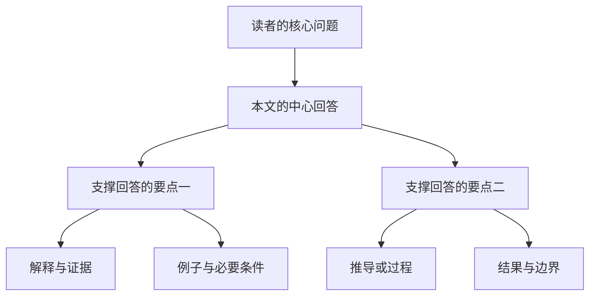
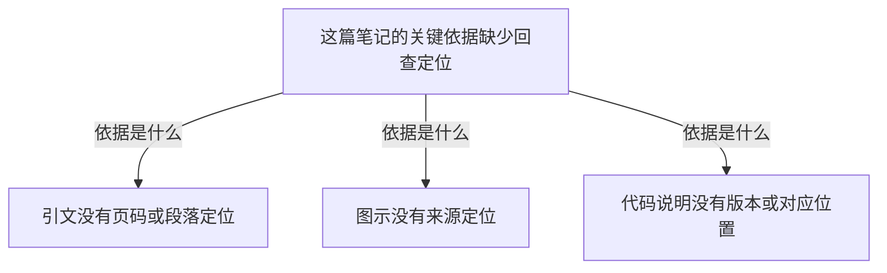

# 金字塔原理：结构化思考与表达

**金字塔原理通过一个中心回答组织多层思想：上层概括下层，下层解释或支持上层，同组思想具有明确关系与顺序。** 它既帮助读者抓住主线，也迫使作者检查自己是否真正想清楚了问题。仅把文章分成几个标题，尚未完成这项工作。

学习时可以沿三条线理解：先确定读者需要什么答案，再检查分组与概括是否成立，最后把已形成的认识呈现为容易理解的文章、图表或演示。书中四篇分别展开这些工作，问题分析为表达提供内容基础。

## 四项原则让细节共同支撑一个回答

第 1 章与附录 3 概括了以下原则（PDF 23–27、293）：

| 原则 | 实际要完成的工作 | 常见偏差 |
| --- | --- | --- |
| 结论先行 | 尽早给出对读者核心问题的回答 | 开头堆积过程，读者读到最后才知道主张 |
| 以上统下 | 用较高层认识概括下层；下层回答它引发的疑问 | 上层只写“有三个方面”，或者比证据宽泛得多 |
| 归类分组 | 让一组思想属于同一逻辑范畴 | 原因、步骤和结果混在同一份并列清单中 |
| 逻辑递进 | 让排列次序有可说明的理由 | 顺序只是想到哪写到哪 |

这里的“结论”可以是判断、解释、建议或方法，不限于论证的最终定理。对尚未查清的问题，本知识库先写当前认识与待验证部分，不能为了开头有答案而制造确定性。

## 纵向回答疑问，横向组织回答

纵向关系决定读者为何需要继续读。比如“这份笔记可以支持独立复习”会引出“凭什么”；下一层需要给出相关支持。若下一层突然变成“作者是谁”，即使信息真实，也没有回答当前疑问。第 2 章将这种展开称为疑问／回答式对话（PDF 29–36）。

横向关系决定这一层如何构成回答：是几个同类的理由共同支持认识，还是一组前提逐步导向结论。两种情况的详细区别见 [[金字塔结构中的归纳与演绎]]。

图为本笔记的教学示意，分支数没有规定为两个。每个要点都应回答上层引出的某个明确疑问；图中同层框不表示所有文章都必须采用同一种论证。

再看一个有具体思想的自拟例子。假设某篇笔记需要回查的关键依据有引文、图示和代码说明三项，检查时发现：

三个下层观察共同支持上层的回查困难，而不是仅与“笔记”这个话题有关。这个判断不等于引文、图示和代码内容已经被证伪，也不意味着其他笔记都应按三类划分。详细的概括与推理区别见 [[金字塔结构中的归纳与演绎]]。

## 构思可以双向进行，成文要照顾读者的顺序

第 3 章同时提供自上而下与自下而上两种构建方法（PDF 37–39、43）。因此，“表达从结论开始”不要求作者尚未分析就先认定答案。

| 已有材料状态 | 构思方法 | 要防止什么 |
| --- | --- | --- |
| 已大致知道问题和答案 | 写下主题、受众问题和暂定回答；用背景与冲突核对，再逐层补支持 | 为既定答案只挑有利材料 |
| 只有零散事实或发现 | 列出要点，识别关系，归类和概括，再倒推它回答的问题 | 把任何看似相关的材料强行归成一类 |
| 写作过程中发现支撑不足 | 回到下层材料，修正分组或收窄结论，再更新开头 | 只润色文字，保留不成立的结构 |

前两行概括原书方法；第三行及对确认偏差的提醒是本项目的使用建议。探索过程可以保留在来源记录，成熟的知识正文则按读者理解问题所需的顺序展开。

## 四篇内容分别解决四类困难

全书的“表达”与“思考”并未割裂：表达结构暴露思考中的缺口，分析得到的结论又成为可表达的内容。

| 书中部分 | 主要解决什么困难 | 对应方法 |
| --- | --- | --- |
| 表达的逻辑，第 1–5 章 | 有内容，却无法让读者快速明白 | 中心回答、疑问与回答、[[SCQA：从读者疑问组织序言]]、归纳与演绎 |
| 思考的逻辑，第 6–7 章 | 列出了很多点，却不知关系与含义 | [[MECE：检查分类的重叠与遗漏]]、[[思想分组的逻辑顺序与概括]] |
| 解决问题的逻辑，第 8–9 章 | 不知道应分析什么、收集什么证据 | [[结构化问题分析：从现状到目标]] |
| 演示的逻辑，第 10–12 章 | 想清楚了，成文或演示仍难理解 | 标题与过渡、幻灯片故事板、把对象及关系写清楚 |

### 呈现方式要暴露真实结构

书面文章中，标题应对应思想层次，同组标题尽量保持句式一致。正文要有独立的主题句和必要过渡，即使暂时遮住标题，也应读得通；标题不能承担全部解释工作（PDF 222、225–228、236、239）。

长而复杂的部分可以小结，但不必结尾再重复一次开头。若文章要求读者随后行动，可以交代由正文自然推出的下一步，而不在结尾突然加入未经论证的新建议（PDF 240、242–243）。

PPT 需要先设计整体故事板，再决定哪些信息用文字、哪些用图表；图表先确定要回答什么问题，再选择表现方式。图题应传达要点，例如说明某项变化，而不只写“数据分析”（PDF 248、251、253–256）。这些方法在本知识库可用于流程图和比较表；原书的比例、行数等经验建议不作为统一限制。

句子层面，可以先识别“谁、做什么、作用于谁、产生什么变化”，画出对象和关系，再写成清楚的文字。它帮助检查抽象语句是否有可解释的内容；不要求所有人都以相同方式在脑中形成图像（PDF 257–264；后一限制为项目理解）。

## 用于学习笔记时，保留推理与证据

在本项目中，一篇复杂笔记通常先交代核心认识与关键条件，再展开支撑它的子问题。通用概念集中维护，案例保留输入、步骤、中间结果和输出；金字塔描述篇内关系，不替代跨笔记的链接网络。

一个可操作的整理顺序是：明确复习问题 → 提取有依据的思想 → 区分分组与推理链 → 确定顺序 → 写出不过度概括的中心回答 → 用案例与边界检查 → 补导航和出处。这是结合原书与本项目制定的应用流程。

完整示范见 [[金字塔原理应用案例：重组一篇RAG学习笔记]]；长期执行要求见 [[知识组织规范|知识笔记组织规则]]。

## 看懂结构不等于结论已被证明

金字塔可以让错误主张显得清晰，因此仍须核验前提、证据和推导。第 31 页的幽默例子本身就区分了理解论述与赞同论述。

本书主要面向思考、商务写作和分析沟通。叙事悬念、逐步探索、原始实验记录可以有其他顺序；学习笔记也不应把复杂现象强行压成没有例外的单一结论。MECE 的覆盖要求只对声明的范围有意义，不能证明现实问题已被彻底穷尽。

## 来源与复习入口

依据用户提供的原书 PDF；上述定位及工具、版本、实际阅读范围集中见 [[《金字塔原理》阅读记录]]。本笔记是跨章归纳，流程图与学习笔记应用是助手补充；没有把原书的商业效果或认知解释逐项独立验证。

复习时尝试回答：

1. 为什么“我想到了五点”还不构成金字塔？
2. 自上而下构思与结论先行分别描述什么？
3. 一个段落形式清楚，但前提不成立，应改结构还是改结论与依据？
