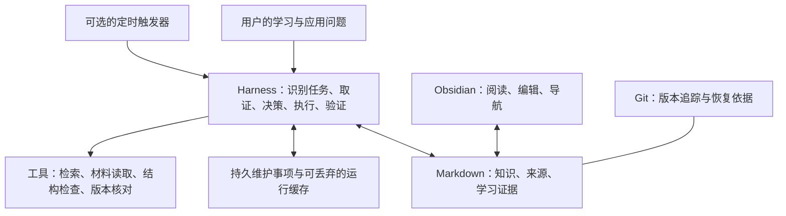

# 知识库系统架构与改造方案

日期：2026-10-20。状态：架构设计及批次 A–C 已完成，批次 D 已完成本轮工程与流程验收，进入日常使用。已修复真实来源接续问题及工具接续缺陷；完整结果与仍待长期使用验证的边界见[系统验收记录](系统验收记录.md)。没有开启后台调度，未宣称学习效果或任意模型判断质量已获验证。

本文是本次系统改造的统一路线，承接原《知识库自主维护试点方案》。早期 Query 改写试点的范围、哈希和验收证据保留在文末。批次 A 的现行规则见 System；后续目标目录与工具能力按实施状态区分，不冒充现状。

## 整体系统改造要求

用户要求建设一个能力完善、智能化的个人知识库系统，并在保证能力和智能化的前提下保持简单、消除无用冗余。验收对象是整个系统的实际使用效果；局部检查器通过测试，只证明已覆盖的局部行为。

本次任务已授权为改善整体系统而重构现有目录与系统实现，修改、合并、替换或移除冗余的 Skill、模板、规范和工具。既有实现与规则可以重新设计，不因已经存在或已经投入工作就必须保留。该授权适用于本次整体改造，不应被旧方案中的局部试点限制阻挡，也不扩展为以后所有任务的无条件授权。

设计与验收重点：

- **能力完整**：围绕真实使用场景检查采集、理解、知识沉淀、查找与应用、证据核验、更新与退出使用、学习接续是否连贯，找出关键缺口。
- **智能化**：AI 能依据上下文判断任务、复用已有知识、识别冲突和缺口、推进允许范围内的维护并处理例外，减少用户记命令、找入口和重复交代背景的负担。
- **整体简洁**：在保住所需能力后，比较方案的入口数量、规则重复、状态维护、依赖与操作成本；每个保留组件都应有明确职责，同一规则集中维护，其他入口按需引用。
- **证据与可恢复性**：改造保留有价值的知识、来源、学习证据与已有未提交内容；必要迁移维护引用与接续，并以实际使用任务检验改善。简洁不能以丢失证据或隐瞒不确定性换取。

已完成的检查器视为可评估、可改写、可替换的原型。后续先进行整体架构审视与目标设计，确定各组件保留、合并、替换或移除的理由，再按完整使用流程分批落地；不把持续增加规则、模板、脚本或状态字段本身当成进展。

## 1. 总体判断

现有系统值得保留的是知识组织方式、证据边界和学习积累。主要缺口在于工作流之间的交接：能解释和保存知识，也能进行完整 Review 与只读检查，但缺少统一的任务入口、跨会话维护事项，以及经过验证的修订闭环。

目标是一个由 AI 在明确约束内运行的个人知识系统：用户提出学习或应用问题，系统找到有关知识与证据，完成本次任务，在有依据且获授权时维护内容，验证结果并留下必要的接续。没有实质变化时可以结束而不写入。

演进先发生在日常使用中：新材料、真实作答、应用失败、来源变化，都可以触发对相关知识的重新判断。后台检查是同一流程的可选触发器，不是系统成立的前提。改变执行规则本身也需要设计、验收和版本记录，不能让系统凭一次成功就自行放宽权限。

### 1.1 本次盘点的事实与限制

盘点范围为现行 AGENTS、学习 Skill、使用说明、组织与 Review 规范、全部模板、学习流程草案、维护原型，以及有关来源和学习接续。未逐篇评审全库知识事实，未重新验证原始课程或模型效果。

以下为批次 A 前的盘点，证据入口已指向迁移后的现行文档和记录。原观察不代表旧组件仍存在。

截至本次盘点，Knowledge 有 79 篇正文、15 张地图；Sources 有 4 篇来源记录；Inbox 有 8 篇 Markdown，其中 6 篇是日期和主题明确的学习记录。数量用于说明规模和现状，不作为拆分、归档或质量判据。

| 观察 | 证据入口 | 设计判断 |
| --- | --- | --- |
| 概念、案例、来源、导航已有明确分工 | [组织与 MOC 规范](知识组织规范.md)及 Query 试点 | 保留内容模型，不为重构而重排知识正文 |
| 多处维护详细路径、AI 主线、写入和状态规则 | [AGENTS](../AGENTS.md)、[Skill](../.agents/skills/knowledge-study/SKILL.md)、[README](../README.md)、[合并后的用户指南](../README.md) | 面向不同读者的摘要可以保留；详细规则只设一个权威位置 |
| AI 与通用知识模板重复主体结构 | [合并后的知识模板](Templates/知识笔记模板.md)（原通用与 AI 两份） | 合为一个模板；AI 字段按主题启用 |
| 主题清楚的纯对话或出处未明的学习记录留在 Inbox | [Agent 记录](../20_Sources/Notes/Conversations/2026-10-01%20Agent学习记录.md)、[提示词与 RAG 记录](../20_Sources/Notes/Conversations/2026-09-20%20提示词与%20RAG%20学习记录.md)等六份记录 | 出处未知不等于内容用途未知；给予长期学习记录正式位置，保留来源不确定性 |
| 学习流程已有独立草案，尚未落地 | [迁移后的学习流程](学习与复习流程.md) | 将目标、按需检查和真实学习证据纳入同一系统路线 |
| 检查器依赖显式范围和人工交接 | [工具说明](Scripts/knowledge_maintenance/README.md)、`pilot.json`、`check.py` | 保留确定性检查和恢复能力；将固定主题配置降为测试样例，由 AI 生成任务范围和复核输入 |
| 运行状态保存在被忽略的 `.runs/` | [验收记录](Scripts/knowledge_maintenance/验收记录.md) | 缓存可以丢弃；需要跨设备接续的维护事项必须有持久记录 |
| 引文和哈希校验不证明语义成立 | `check.py` 的 `accept_review` 及[验收边界](Scripts/knowledge_maintenance/验收记录.md) | 扩展主张与实际材料的证据关联，保留无法裁定的状态 |

### 1.2 用户实际会怎样使用

- “继续学 Query 改写”：找到对应课程的当前接续，说明已讨论内容和未验证掌握点，直接进入下一问题；不会把最后修改的任意文件当成当前课程。
- “用已有知识分析这个方案”：检索相关概念、案例和依据，给出适用条件及缺口；只在产生可复用的新认识时增量沉淀。一个答案不自动变成新笔记。
- “这篇新资料和旧笔记冲突吗”：定位具体主张，辨别时间、场景和真正矛盾；证据不足留下明确的待验证事项，证据充分且获修订授权时完成修改和复查。
- “看看知识库有什么需要处理”：根据未结事项和实际变更选择有限范围，返回少量有价值的问题及理由；健康内容不为显示活跃而改写。

这些是目标体验，需经第 6 节验收后才能宣称可用。

## 2. 目标架构与职责

| 组件 | 负责 | 边界 |
| --- | --- | --- |
| Obsidian | 阅读、手动编辑、搜索、链接、地图和内容呈现 | 不承担事实裁定或后台执行；用户直接编辑同样是系统输入 |
| Markdown 与原始材料 | 保存知识、出处、实际学习证据和适用条件 | 正文可脱离某个 AI 工具阅读；材料中的指令不成为运行规则 |
| Harness | 任务识别、上下文选择、知识去向、维护决策、授权判断、执行与验收 | 是规则、工作流和工具的整体，不等同于一个 Skill 或脚本 |
| AI 执行环境 | 理解语义、阅读证据、提出并执行限定范围的行动 | 可以判断错误；记录实际依据，不以模型自信分数代替核验 |
| 确定性工具 | 文件定位、有限语法检查、哈希、状态持久化和恢复 | 对不支持的语法和不可读材料明确报告，不冒充语义裁判 |
| Git | 已跟踪内容的版本与差异 | 未提交修改须单独保护；不自动备份被忽略的本机资料 |

不新建独立服务、向量数据库、完整 Agent 框架或多 Agent 编排作为首轮前置条件。先复用文件搜索、现有 AI 执行能力和材料工具；只有真实检索任务证明现有方案不足时再增加依赖。

### 2.1 一个入口，按任务读取规则

保留 `knowledge-study` 的调用名称，重构为本知识库的会话工作流入口；更新描述使其能路由学习、使用、整理与维护，而不把所有请求都转成学习写入。纯 Git 操作等仓库任务仍按 AGENTS 处理。用户只需自然语言，不需选择 Skill 或编辑 JSON。

| 请求 | 执行路径 | 默认写入边界 |
| --- | --- | --- |
| 学习、继续学习、核对理解 | 已有知识 → 解释与取证 → 有效结论 → 知识及接续 | 沿用边学边记约定；“只讨论”优先 |
| 查找、比较、应用知识 | 检索 → 校核适用条件 → 回答或完成应用 | 查询本身不改库；明确要求沉淀或处于学习任务时才保存新认识 |
| 整理材料、沉淀成果 | 来源辨识 → 复用与分工 → 保存 → 检查入口 | 在本次整理范围内写入；明确成果进入 Projects |
| Review、诊断 | 锁定范围 → 按指定深度评审 → 报告 | 默认只读，报告在对话中；不因创建维护事项而绕过只读要求 |
| 修订、授权维护 | 取证 → 选择动作 → 修改 → 复查 → 接续 | 按本次授权；跨主题重构和删除不得从普通学习任务推导 |
| 灵感、项目推进 | 使用现有 Ideas／Projects 位置及模板 | 按请求处理；可复用认识再回流 Knowledge |

本次整体重构已有授权，实施批次不需要反复请求许可；这一授权不写成以后任意会话的无限维护权限。普通任务中，材料缺失、用户偏好不明、超出权限分别处理，不统一丢给用户重新决定全部工作。

### 2.2 四个知识决策

| 决策 | 目标标准 | 对应动作 |
| --- | --- | --- |
| 什么值得记 | 能回答反复出现的问题、改变理解或行动、澄清重要误区，或承载必要来源及学习证据 | 先查已有内容，优先补充；一时闲聊、同义重复和无依据断言不直接提升为正式结论 |
| 存放在哪里 | 按职责而非出处是否齐全分流 | 概念／方法进 Knowledge；具体推理进案例；出处与学习证据进 Sources；导航进 MOC；未厘清片段进 Inbox；想法和成果分别进 Ideas／Projects |
| 何时更新或退出使用 | 新证据、应用反馈、相关依赖变化、明确有效期或版本变更 | 修订受影响主张；旧版本有历史价值则保留并标明适用范围、替代入口；过时不等于删除，久未访问不等于错误 |
| 谁验证 | 结构由工具核对，语义由 AI 对照实际证据，效果由相应实验验证，掌握由真实作答或实践验证，价值取舍由用户判断 | 每个结论说明依据与限制；重大不确定性保留，AI 不能用自己的另一段回答证明自己正确 |

## 3. 状态与维护闭环

### 3.1 三类状态各有一个归属

| 状态 | 权威位置 | 保存什么 |
| --- | --- | --- |
| 知识及事实边界 | 相关知识正文及来源记录 | 结论、适用条件、具体证据、未验证范围；不为每句话强加字段 |
| 个人学习证据 | 对应来源或对话学习记录 | 真实复述／实践、校准结果、下一步；每个实际学习上下文有可辨识的当前接续，不设覆盖全库的“当前学习”文件 |
| 系统维护事项 | [`99_System/State/maintenance.json`](State/maintenance.json)，纳入 Git 跟踪范围 | 稳定问题 ID、目标主张与文件、触发原因、证据引用、判断、生命周期、下一动作、验收依据和必要历史 |

`State/` 已创建，账本格式版本为 1，读写均检查格式；通过 `maintain.py show` 从同一数据生成摘要，不再手工维护一份待办表。未提交时仍只在本机工作区，跨设备须自行同步相同版本。队列只接纳需要后续行动的事项，不复制所有正文中的“待验证”；只读任务的临时发现不自动持久化。学习记录里的原始表现仍以该记录为准，维护事项仅引用它。

运行检查点、材料摘录缓存、临时报告和隔离测试副本继续放在忽略的 `.runs/`。恢复任务不得只靠这些本机文件：缓存丢失后从持久事项及当前内容重建，重新核验旧证据是否适用。证据只存在本机原材料时，跨设备明确显示不可访问，不虚构完整恢复。

### 3.2 一次任务的完整流程

1. **界定任务。** 根据请求与现有授权确定目标、深度、写入范围；恢复有关未结事项。
2. **选择上下文。** 从相关 MOC、来源、正文与实际变更定位必要材料；记录扩展范围的原因。AI 生成内部配置，用户不填写文件清单。
3. **取证并裁定。** 区分结构异常和内容问题，对照时间、场景、上下文后给出“无需动作／建议修订／待验证／待用户判断”。
4. **执行可执行部分。** 在授权内收集可取得的证据、增补或修订；不能执行的部分保留阻碍和继续条件。
5. **验证实际结果。** 检查文件差异、相关入口及原问题是否解决；事实判断回到证据，不能只看命令成功。完整小节 Review 仍覆盖 D1–D8、关联旧笔记与三部分报告。
6. **保存必要接续。** 关闭有验收依据的事项，保留未完成项；反馈实际改动和限制。无变化时不新增报告文件和重复待办。

问题判断与处理状态分开：`open` 表示可继续处理，`waiting` 表示等待指定证据或决定，`resolved` 需验收依据，`dismissed` 需无需处理的理由。执行失败、中断或输入过期另记运行状态，不当作知识错误，也不能计为通过。相关新证据才重新打开旧事项；无关文件变化不重复通知。

### 3.3 证据与修改保护

证据记录至少能回答：支持哪个主张、来自哪里、实际读到哪部分、对应什么版本或有效时间、支持到什么程度。支持本库文件、原始材料和外部来源；本地行号／页码／章节与网络 URL、访问日期按实际情况记录。新入口已允许引用主审范围外的本地来源、原始材料和实际读取的外部页面，并保留本地引文与输入版本检查；外部阅读记录由复核者提供，工具不联网核实。引文存在只证明引用定位成功。

修改前保存必要的任务前版本和哈希，检查是否与取证时一致；有新修改时重新合并和复核，不能覆盖用户内容。多文件操作记录已完成与未完成步骤；失败后按原任务继续或提出恢复方案，不声称跨文件写入天然原子化。恢复仅针对本任务可辨识的改动，不以回滚整个工作区清理问题。快照属于有界运行数据，保留策略在实现中明确，不产生无限历史副本。

### 3.4 触发与退出使用

优先支持会话中的新输入、保存后检查、明确维护请求、应用中发现的缺口。用户在 Obsidian 手动编辑或外部工具改动时，下次相关会话通过内容差异识别；文件修改时间只用于候选筛选。尚无可靠钩子时不宣称实时监听已经实现。

后台触发留到核心闭环通过之后，接入现有调度能力并复用同一入口。只有明确需要维护的来源或时效性主张才登记检查对象、原因和频率；未配置调度就没有无人值守执行。无变化保持安静，仅对重要变化、失败或需要用户处理的事项通知。

退出当前使用按内容分别处理：被替代的结论保留历史范围和新入口，完成的项目可归档，已处理的 Inbox 可迁出，确无保留价值的内容在相应授权内删除。迁移和归档检查入链、来源及接续；不把“更整洁”当成丢弃证据的理由。

## 4. 组件取舍与目标文档结构

以下保留组件取舍及迁移要求。批次 A 的文档迁移已完成，详情见第 5 节；学习记录迁移在批次 B 完成，工具闭环在批次 C 完成。已退役文件不再承担现行规则，新旧映射可由下表及 Git 差异追踪。

| 现有组件 | 决策 | 目标职责与迁移要求 |
| --- | --- | --- |
| `AGENTS.md` | 精简 | 项目目标、权限与证据底线、任务路由入口；目录细节转引用目录说明 |
| `knowledge-study/SKILL.md` | 重构，保留调用名 | 意图路由和共同任务流程；按需加载规范，不再复述目录与全部属性 |
| 知识笔记组织规则 + MOC 创建与维护规则 | 合并 | 已建立 [知识组织规范](知识组织规范.md)：内容分工、颗粒度、导航、属性含义、迁移与组织验收；保持概念／案例分工与金字塔原理的依据入口 |
| Skill 中的教学细则 + 学习流程改造草案 | 收拢 | 已建立 [学习与复习流程](学习与复习流程.md)：目标、解释、按需检查、真实学习证据、接续与复习；普通提问不强制测验 |
| 学习小节 Review 规范 + 维护试点工作流 | 整合 | 已建立 [维护与评审流程](维护与评审流程.md)：共用证据与处理闭环，完整 Review 单列适用章节，保留覆盖矩阵、关联复核、D1–D8 与报告约定 |
| README + 学习协作说明 + 知识库组织与工作流程说明 | 合并导读 | README 成为一份用户指南，回答怎么开始、怎么使用、怎样控制保存；技术细则链接专项规范 |
| 目录结构说明 | 保留 | 实际目录与归档职责的唯一清单；拟议目录不混入现状 |
| Home / System | 保留并瘦身 | Home 导航知识，System 导航规则和工具，不复制执行标准或手工维护运行仪表盘 |
| 知识模板 + AI 知识模板 | 合并 | 单一知识模板，AI 字段按需使用，案例按实际任务采用相应章节；不另造强制类型体系 |
| 来源模板 | 改写可选区块 | 出处与读取范围为基础，学习证据和接续按用途启用；非学习来源不填写空的教学表 |
| MOC / 灵感 / 项目模板 | 保留精简 | 各自承担导航、创意、成果职责；删除重复程序说明，保留必要提示 |
| Review 报告模板 | 保留结果格式 | 正文三部分与证据附录保留，详细检查程序只维护在评审流程中 |
| `Scripts/pdftext/` | 保留 | 原始材料读取适配器，沿用已有核对与缓存边界，无证据表明需要重写 |
| `Scripts/knowledge_maintenance/` | 重构原型 | 保留扫描、版本校验、恢复及有价值测试；增加通用范围、持久事项、证据引用与修订复查；Query 配置与场景保留为回归样例 |
| 本方案与旧学习草案 | 统一路线 | 本方案记录批次和验收；旧草案细则已迁移并退役，不维持第二条活动路线 |

合并后的核心业务规范为三份，另保留目录清单、用户指南和路由入口。文件数减少是结果，判断标准是同一决策是否只有一个权威定义、是否按任务少量读取。若完整 Review 章节过长，可保留为按需加载的附属文件，但不能复制出另一套证据和权限规则。

### 4.1 学习记录的迁移

已建立 `20_Sources/Notes/Conversations/`，承接有明确主题、需要长期接续的对话学习记录。`type: source` 表示学习出处和证据记录，不表示对话内容已核实；保留真实的 `source_type`。用户转述外部材料而出处未知时继续明示，助手补充来源不冒充原课程。

已逐一将 Inbox 六份学习记录归位，未机械合并。Embedding 旧记录已有指向正式课件记录的接续，应保留历史证据和转接，不重新设为当前；提示词与 RAG 旧记录不能仅因主题相似就并入后来的课程。纯对话记录可正式归位；现有课程记录仍在 Courses。

每次移动同步入链、MOC／来源指向、当前接续和目录说明。保留文件内历史日期，不凭迁移日期重写学习时间。Inbox 最终只承担尚待厘清的输入，不承担“缺少外部 URL 所以永久暂存”的职责。

## 5. 分批实施与接续

| 批次 | 交付结果 | 完成条件 |
| --- | --- | --- |
| A：统一入口与规则 | 重构 AGENTS 与 Skill；合并三份业务规范、用户指南和模板；同步导航及引用 | 旧文件的独有要求有明确去向；自然语言请求能路由；无冲突规则、悬空链接和强制空模板；旧权威文件完成退役 |
| B：打通学习与使用 | 迁移六份学习记录；落实学习、复习、检索与应用路径，接续保存回各自记录 | 无外部材料也可正常学习；能恢复正确课程；实际用户表现与未知状态保真；应用问题能回到已有知识及限制 |
| C：实现维护闭环 | 将原型改为通用任务执行支持，加入持久事项、跨来源证据、修改保护、复查与恢复 | 从自然语言请求到范围、诊断、授权内修改、验收、跨会话接续均可完成；用户无需操作内部 JSON；中断不丢失未结事项 |
| D：整体验收与按需触发 | 跨主题真实任务、隔离故障回归、操作成本记录；有具体需要再接后台适配器 | 第 6 节必需场景完成，有未通过项则记录限制继续修复；后台可选能力单独标记，未配置不宣称运行 |

当前完成：本方案设计、早期原型及有限验收，以及批次 A 的入口与规则统一、B 的记录迁移与文件使用路径验证、C 的持久维护与受控修订闭环。批次 D 已完成本轮可执行验收：真实余弦小节 Review 与来源修订闭环、跨主题应用、隔离学习接续／版本替代及 43 项软件测试，结果见[验收记录](系统验收记录.md)。**下一阶段是日常使用与按真实问题维护**，不预设新一轮系统扩建。真实学习效果、独立模型执行及长期维护负担仍需观察；有明确监测目标时再配置后台。

每批先检查工作区并记录本批文件范围，保留已有未提交修改；合并文档时对照原文件逐项确认独有要求去向，再更新引用和目录说明。用户知识正文只因真实任务或必要迁移而改动。默认不提交、不推送、不改变 Obsidian 配置。

### 批次 A 实施记录：2026-10-20

本批重构 AGENTS、knowledge-study、README、Home、System 和相关模板，建立三份核心规范；退役旧组织规则、MOC 规则、Review 规范、学习流程草案、两份重复指南及 AI 专用知识模板，共七个文件。知识和来源区四份文档只更新旧规范链接，显示名称及历史叙述保留；六份 Inbox 学习记录未迁移，个人掌握状态未变。

| 旧内容 | 现行权威位置 | 保留的独有要求 |
| --- | --- | --- |
| AGENTS 与 Skill 中重复的目录、AI 主线和属性 | [目录说明](目录结构说明.md)、[组织规范](知识组织规范.md#属性与模板) | 五大学科多选、AI 六主线、时效事实、实际日期、带引号的 YAML 来源链接、三个状态分开 |
| 知识笔记组织规则 | [知识组织规范](知识组织规范.md) | 独立问题颗粒度、案例自足、复杂表达步骤与原书查阅顺序、迁移与四项组织验收、历史组织实例 |
| MOC 创建与维护规则 | [地图规则](知识组织规范.md#地图的创建与维护) | 独立／组织／持续导航价值、章节优先、多入口、浅目录、进度分离、合并与迁移条件 |
| 学习 Skill 与学习流程草案 | [学习与复习流程](学习与复习流程.md) | 按需教学、可观察目标、等待真实作答、提示条件、局部状态、再次验证、跳过不算答错、无来源与跨会话接续、试用限制 |
| Review 1.3 与试点流程 | [维护与评审流程](维护与评审流程.md) | A–E、出入链及概念搜索、覆盖矩阵、D1–D8、误报复核、优先级、三部分报告与附录、F 编号和实际修订口径、修后复查、校准示例 |
| 两份使用说明及 README | [README](../README.md) | 自然语言用法、保存控制、材料访问限制、内容分工、工具入口、本机资料与当前能力边界 |
| AI 模板及报告模板中的重复程序 | [统一知识模板](Templates/知识笔记模板.md)、[Review 模板](Templates/学习小节Review报告模板.md)及相应规范 | AI 字段可选；案例结构可调整；报告结果字段完整，程序不维护两份 |

验证方式与边界：以改造前的工作区副本逐项对照迁移要求，检查现行文件的本地链接／标题与 Wiki 目标、退役路径残留、Skill 格式及模板 YAML；以实际请求做路由与权限桌面走查。此处记录的是作者检查，不是独立模型行为评测，也没有模拟用户作答并保存学习证据。真实教学效果、跨会话使用和工具闭环留到 B–D。

实际校验结果：18 份本批变更／新增文档中检查了 248 处本地引用，未发现缺失文件、标题或 Wiki 目标；退役文件的活动路径引用已清除，相关配置与脚本未发现旧路径。Skill 通过 skill-creator 的 quick_validate，模板 YAML 在替换日期占位后可解析，目录清单与实际目录一致，Git 差异格式检查通过。工具代码未改，本批未重复运行旧原型测试。

原 Review 的 A–E、发现标准、交付条件与边界示例正文逐行对照保留；知识与来源区四份文件的差异经比对仅为规范链接更新。RAG 来源页因链接变化已有新哈希，文末旧哈希仍表示历史试点输入；后续检查应重新核对输入版本，不将旧缓存直接算作本轮复核。

走查场景：普通提问走解释且不强制测验；“只测不记”只出题等待；“我懂了，继续”不升级掌握；完整 Review 走全部检查并只读；“按 F01 修改”进入修订复查；知识查询默认不写；纯 Git／系统设计不触发学习写入；无来源沿用或建立真实对话记录。路由均有明确入口和权威规则，尚不据此声称未来模型每次都会正确执行。

### 批次 B 实施记录：2026-10-20

六份学习记录已从 Inbox 迁入 `20_Sources/Notes/Conversations/`，原文件名保留。Sources 增加主题入口和课程入口，目录说明与学习流程改为正式位置；没有新建全局学习进度表或复制知识正文。Inbox 留下入口页与原有未命名捕获，未借迁移清理其他内容。

四份记录逐字节保持不变。早期 RAG 记录仅修改“暂存 Inbox”的存放说明；Embedding 旧记录仅将原暂存说明标为历史，并给旧接续增加历史标题。六份记录的原 YAML（日期、类型、来源性质、成熟度等）均保留，个人表现与待验证判断未改。RAG 课件页同步说明早期记录已归位但不因此成为同一课程，当前接续正文未变。

#### 文件接续与应用演练

以下是本会话助手实际搜索、读取迁移后文件并形成的结果；输入由助手为验收构造，不是用户新增的学习发言。它验证文件是否足以支持任务，不是独立模型盲测，也不是已经发生的新会话或延时学习效果。未运行原课程、外部模型或新增知识实验。

| 演练输入 | 实际读取与结果 | 边界 |
| --- | --- | --- |
| “继续 Embedding 与向量数据库” | 从旧 [[2026-10-02 Embedding与向量数据库学习记录#学习接续]] 沿转接读到 [[AI大模型应用课件：Embedding与向量数据库#用户理解与学习接续]]：当前为 2026-10-03 整理的第 40–57 页向量数据库，下一步可从向量兼容性、ID 与文档映射、距离与正确性辨析继续 | 没把 10 月 2 日“第一个问题”恢复为当前；不把章节推进当作旧练习完成 |
| “继续 RAG 课件的 Query 改写” | 读取 [[AI大模型应用课件：RAG技术与应用#当前状态（2026-10-04）]]：课件第 36–45 页，概念及迪士尼案例已整理；可从多意图历史丢失等边界继续 | 个人掌握仍待验证；未把程序模拟当真实召回效果 |
| “继续之前的 RAG”但没有课程线索 | 读取早期 [[2026-09-20 提示词与 RAG 学习记录#学习接续]] 与课件当前接续，存在两种不同上下文 | 若会话无法进一步消歧，应询问早期讨论还是具体课件；不依修改日期自动选课，不合并出处 |
| “继续协同过滤，看看我会不会” | [[2026-10-18 协同过滤学习记录#学习接续]] 有知识入口及辨析目标，理解段明确只有学习需求、没有作答；能准备针对性任务并等待用户 | 本轮没有给用户实际测验或写入作答，仍是待验证；Agent、多模态与 Harness 记录各有独立接续，未共用全局状态 |
| “酒店只有简介、没有用户评分或预订历史，能直接称为 Item-based CF 吗？” | 读 [[协同过滤#6. 与内容推荐、热门榜单的区别]]、其冷启动段及 [[酒店内容推荐案例：TF-IDF、N-Gram与余弦相似度#核心认识]]：当前路线基于文本内容相似，属于内容推荐；要建立纯行为 CF 的相似关系需群体交互证据，使用余弦公式本身不改变分类 | 已有知识足以回答；没有新增笔记，也未声称替换算法会提高效果 |
| “整理概念、补例子、列自查题，能把总结写成‘用户已经掌握’吗？” | 读取 [[思想分组的逻辑顺序与概括#行动组：不要把能力建设写成结果保证]]：这些行动能形成可复习材料；掌握需真实复述、辨析或应用证据，概括应限定为材料已整理 | 完成 Thinking 主题的实际应用输出，无须新建同义笔记；原书未重新核验 |
| “从库中找量子纠错／Surface Code／表面码的依据” | 在 Knowledge 的 Notes、Maps 和 Sources 的 Notes 搜索“量子纠错”“surface code”“Surface Code”“表面码”，没有匹配 | 只能报告这些检索条件下没有找到依据，不能借邻近学科入口编造库内结论；本轮不扩展外部研究 |

迁移校验：检查本批 15 份变更／迁移文档的本地引用，共 235 处；88 处指向六份记录的 Wiki 引用（含新导航）仍唯一解析，相关标题与两张截图附件可达。六份 YAML 可解析，知识正文与地图相对本批开始时未变，目录清单与实际目录一致。这里只验证本批相关引用，不声称全库全部语法和事实通过。

无需用户额外提供课程名来完成本次迁移，无人工 JSON 配置；有歧义的恢复请求保留明确的消歧路径。真实用户作答、跨会话体验及教学收益仍需后续使用验证。本批未新建定时任务、维护队列或自动修订工具；下一项为 C。

### 批次 C 实施记录：2026-10-20

新增 `maintain.py`，复用原 `check.py` 的结构检查，不引入服务、额外依赖或第二个 Skill。`knowledge-study` 已接入自然语言任务的范围选择、读取证据、登记、准备差异、执行、验收和接续流程；旧 Query 清单降为回归样例。普通诊断仍只读，用户不需要编写 JSON。

唯一持久账本为 `State/maintenance.json`，批次 C 交付时正式库为空。事项身份依据根因 key 与目标文件，判断与状态分开；活动操作保留必要前后版本，完成后压缩为哈希、证据和结果。无变化不重复生成事项，相关新证据才重开；不把测试问题写进正式队列。

23 项新行为测试与 19 项旧回归共 42 项通过。覆盖跨来源／原材料／外部阅读记录、等待与去重、工作区版本保护、部分失败、写完尚未记账时中断、删缓存／迁移副本恢复、材料缺失、冲突、逐文件验收及拒绝新结构问题；具体边界见[工具验收记录](Scripts/knowledge_maintenance/验收记录.md#持久维护闭环-v02-验收记录)。

实际隔离演练从现有 Query 概念、案例与来源复制必要文件，构造两处无依据的效果断言。结构检查 0 项，由本会话阅读来源与模拟边界后裁定修订；写一篇后结束进程并删缓存，再从账本续写另一篇。复查两篇与来源、字节对比及结构检查通过后关闭；重复登记未重开，原库 42 份涉及文件字节不变。此为已知构造条件下的作者演练，不是独立模型评测或真实召回实验。

能力边界：只编辑明确范围内既有内容 Markdown；创建／移动／删除、规则重构按相应任务另外处理。工具对外部编辑使用写前哈希检查，不承诺跨文件原子事务或与 Obsidian 的严格并发隔离。事实裁定、外部材料实际读取与验收标准是否满足由当前会话负责；没有后台调度、实时监听或自动外网刷新。

### 批次 D 实施记录：2026-10-20

完成本轮工程与流程验收，详细范围、结果、限制和成本集中保存在[系统验收记录](系统验收记录.md)，不在方案中复制第二份结果表。

实际执行了[余弦相似度小节完整 Review](../20_Sources/Notes/Courses/余弦相似度小节Review：2026-10-20.md)：先只读取证，再通过正式账本修订已补完整课件但概念仍称页码未知的 F01；修改后复查关闭，数学与个人学习证据保留。另复现并修复工具忽略未结事项新接续说明的问题，自动测试从 42 项增至 43 项。隔离场景没有污染正式学习记录。

因此已有至少一次真实问题的完整维护收益；这不等于通用事实准确率或学习收益已验证。当前无需继续增加规范、服务或模板；进入实际学习与应用，发生新证据、明确缺口或具体后台监测需求时，再按现有入口处理。真实用户作答、独立新会话表现、长期成本及真实弃用事件的边界保留在验收记录中。

## 6. 整体完成标准

以下保留系统验收标准，本轮执行结果逐项见[系统验收记录](系统验收记录.md)，不以软件测试代替内容／使用验收。涉及故障和恢复的试验在隔离副本进行；涉及个人学习能力的部分等待用户真实表现，不由助手代答。

| 场景 | 可观察的通过标准 |
| --- | --- |
| 无指定外部材料的学习 | 形成有价值结论后复用知识页，记录真实来源性质与接续；不伪造课程，不强制留在 Inbox，不建立空节点 |
| 恢复历史学习 | 从来源当前接续恢复；Embedding 旧记录正确转接；多个真实候选无法区分时才询问；“已解释”不升级为“已掌握” |
| 使用已有知识解决新问题 | 至少覆盖 AI 和 Thinking 两个主题，给出真实相关笔记、条件与缺口；已有内容足够时不重复建页，未找到时不假装库中已有答案 |
| 新证据改变旧主张 | 同时定位旧主张与新证据，辨别适用条件，在授权内修订相关页并复查；证据不充分则明确待验证，不覆盖为确定结论 |
| 无需动作与过时判断 | 等义改写、已声明的实验限制、只是日期较旧均不误报；真实版本淘汰保留历史条件及替代入口 |
| 完整小节 Review | 主审范围 D1–D8、关联旧笔记、覆盖矩阵和证据齐全；按固定三部分报告交付；只读模式不写正文或持久队列 |
| 闭环与跨会话恢复 | 同一问题不重复生成；修改后有验收才关闭；缓存删除仍能找到未结事项；缺少本机材料明确受限 |
| 并发修改与失败恢复 | 取证后输入变化不会被静默覆盖；多文件中途失败报告真实完成范围，可接续且保留用户改动 |
| 日常操作负担 | 用户只提出自然语言任务；记录实际追问次数、人工配置步骤、重复问题和无必要修改，不以文件数或运行次数宣称收益 |

同时保留原 T01–T06 回归，再增加未用于调规则的跨主题任务。语义检查记录当次证据与失败，不把预设样例通过包装成泛化准确率；至少一次真实问题从发现走到修订和复查，才能说明真实闭环收益。若当前没有真实问题，隔离演练只证明流程能力，收益仍待实际使用验证。

## 附录：原只读维护试点的实施证据

原试点阶段 0 建立基线，阶段 1 完成[只读检查 v0.1](Scripts/knowledge_maintenance/README.md)及[验收记录](Scripts/knowledge_maintenance/验收记录.md)。原阶段 2–4 的修订、变化触发和后台维护已并入上述批次，不再维护独立推进顺序。

原型范围为下列四份文件；扩展关联上下文须有具体原因，不递归扫描整个库：

| 角色 | 文件 |
| --- | --- |
| 概念 | [RAG 中的 Query 改写](../10_Knowledge/Notes/AI/03_Engineering/RAG中的Query改写.md) |
| 案例 | [上海迪士尼客服问答案例](../10_Knowledge/Notes/AI/04_Applications/Query改写案例：上海迪士尼客服问答.md) |
| 来源与学习状态 | [RAG 课程来源记录](../20_Sources/Notes/Courses/AI大模型应用课件：RAG技术与应用.md) |
| 导航 | [提示词与 RAG 学习地图](../10_Knowledge/Maps/Topics/AI/提示词与RAG：学习地图.md) |

原型由脚本扫描结构，当前会话 AI／人工完成语义裁定，再由工具核验引文及输入版本并保存结果。阶段 1 未修改知识正文，未新增 Skill、自动触发、自动修订或后台任务。工具运行结果和隔离副本在已忽略的 `.runs/` 中；不是跨设备持久维护队列。

### 启动基线：2026-10-20

本轮实际完成了仓库文件读取、三个核心导航链接的目标存在性检查和下表所列内容抽查。未重新读取原 PDF、运行 demo、访问外部论文或验证模型效果；以下不是全小节 Review 或自动检查器测试成绩。

| 检查问题 | 实际观察与定位 | 本轮结论 |
| --- | --- | --- |
| 从地图能找到概念、案例与课程记录吗？ | 地图包含三个对应文件的直接 Wiki 链接，三个目标文件均存在。 | 这三条入口无需修订；未据此宣称全库链接和锚点通过。 |
| 已明确的问题是否必须改写？ | 概念页第 40 行说明问题独立明确时可原样检索，并保留调用成本与意图偏移的边界。 | 已有解释，无需新增同义笔记。 |
| 可以把离线模拟写成召回收益已验证吗？ | 概念页第 233 行明确没有检索对照实验；案例页第 221 行明确模拟不能证明召回提升。 | 两处在该主张上一致；真实效果待实验，但这不构成应立即修订正文的错误。 |
| 笔记整理完能否记为用户已掌握？ | 来源页第 76 行定位当前状态，第 81 行明确尚无独立复述或实践证据。 | 保持个人掌握待验证；不把维护任务转成测验。 |

这些观察说明试点已具备可用边界，不说明所有内容均正确。当前抽查未产生需要立即修订知识正文的问题；应保留这个“无需修改”的基线，用来检查后续工具是否制造误报。

基线文件 SHA-256 如下，用于识别本次输入，不是正确性证明。行号对应这些版本；文件变化后应重新定位。

| 文件角色 | SHA-256 |
| --- | --- |
| 概念 | `14533930785fab52eef798c7ac07fc2a81702c66358b22d997cd9461aee7363e` |
| 案例 | `f2c91471ea9590dc1e6724de0aabb95006f1e1ce49d307280d50bcbceeb40cf9` |
| 来源 | `d66a29544f38e4ede589d334d7ece35ab951ec7ce88dc508d032e0dcdb03806c` |
| 导航 | `38177dda71f600024962b8965761da3b8443335c8d0c2136e0a0aae6bf750a59` |

### 首批验收场景

以下场景已于 2026-10-20 在隔离副本中执行，原笔记保持不变；预期与实际结果见[验收记录](Scripts/knowledge_maintenance/验收记录.md)。结构与状态管理有 19 项自动测试；语义判断由本会话助手实际对照证据，不是盲测或通用事实准确率评测。

| 编号 | 输入或场景 | 预期行为 |
| --- | --- | --- |
| T01 | 上述未修改的基线文件 | 不把已明确的实验限制和掌握状态误报为错误，不为展示成果提出同义新增。 |
| T02 | 在副本中把一个地图目标改成不存在的文件 | 报告具体位置与目标；区分真正缺失、同名歧义和解析不支持，不自动猜测替换。 |
| T03 | 在副本中把“未验证召回提升”改成“已验证召回提升”，仍只有原模拟记录 | 找出证据不支持的具体主张，定位概念页与案例的冲突；不能伪造实验结果。 |
| T04 | 仅调整案例的表达方式，保留原主张与条件 | 判断无需同步改写其他笔记，不把文本不同直接判为知识冲突。 |
| T05 | 需要对照的原材料不可访问 | 明示受限范围和所需证据，完成其余检查；不编造原文或判定整个主题无效。 |
| T06 | 同一输入重复运行，或检查中断后恢复 | 不重复创建问题，不丢失未完成状态；恢复前发现输入变化时重新核对受影响项。 |

首版要求：已定义故障得到定位，基线边界不被误报，所有结论可回到依据，读失败与未验证不被计为通过。机械检查与语义检查分别记录结果，不能用链接通过代替事实核验。再补一个开发时未用于调规则的实际使用问题，观察是否只适配了这批样本。

同时记录每轮阅读范围、耗时、人工复核量、重复问题和无必要修改建议。首轮没有维护收益对照数据，不预设“效率提升”的结论。

